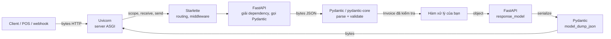

# Module 00 — Tổng quan & bài toán

> Thời lượng: ~20 phút · Mức độ: Cơ bản · Tiên quyết: không

Hầu hết sự cố nghiêm trọng của phần mềm không nằm ở thuật toán khó mà nằm ở **ranh giới**: chỗ dữ liệu đi từ hệ thống này sang hệ thống khác và một bên đã ngầm giả định điều gì đó về hình dạng của dữ liệu. Khóa học này dạy hai công cụ Python được thiết kế chính xác cho chỗ đó — **Pydantic** (biến dữ liệu thô thành đối tượng có kiểu, đã kiểm tra) và **FastAPI** (biến hàm Python có kiểu thành một HTTP API đầy đủ) — nhưng đi xa hơn mức "cách dùng": vì sao chúng được thiết kế như vậy, bên trong chạy ra sao, tốn bao nhiêu, và đặt chúng vào một hệ thống thật như thế nào.

## Mục tiêu học tập

Sau module này, bạn có thể:

1. Giải thích vì sao **dữ liệu ở ranh giới hệ thống** là nguồn lỗi lớn, bằng ít nhất hai sự cố công khai có tài liệu.
2. Mô tả vai trò của Pydantic và FastAPI trong một service Python, và vị trí của chúng trong hệ sinh thái (số liệu sử dụng, dự án tiêu biểu).
3. Trình bày hai dịch vụ của case study Mekong Cloud và ước lượng tải của chúng bằng chuỗi nhân Fermi.
4. Chỉ ra vì sao hai dịch vụ đòi hỏi **quyết định thiết kế khác nhau** (async/sync, số worker, timeout).
5. Chọn lộ trình học phù hợp với mục tiêu của mình trong 16 module và 6 lab.

---

## 1. Vấn đề: dữ liệu ở ranh giới

### 1.1. Ranh giới tin cậy

Một service web nhận dữ liệu từ những nguồn **mình không kiểm soát**: client HTTP, webhook của bên thứ ba, hàng đợi tin nhắn, file người dùng tải lên, và ngày nay là cả **output của LLM**. Mỗi nguồn là một *ranh giới tin cậy* (trust boundary): bên trong, code của bạn giả định dữ liệu có hình dạng nhất định; bên ngoài, không ai hứa điều đó.

Có hai chiến lược xử lý dữ liệu qua ranh giới:

- **Kiểm tra rải rác (shotgun validation)**: nhận `dict`, đi tới đâu kiểm tra tới đó (`if "total" in d and isinstance(d["total"], int) ...`). Code nghiệp vụ lẫn với code kiểm tra; một nhánh quên kiểm tra là đủ để dữ liệu sai lọt vào sâu bên trong.
- **Parse một lần ở cửa**: ngay tại ranh giới, biến dữ liệu thô thành một **kiểu** chặt chẽ (`Invoice`), hoặc từ chối toàn bộ. Sau cửa, code chỉ làm việc với `Invoice` — kiểu dữ liệu chính là bằng chứng rằng dữ liệu đã được kiểm tra.

Chiến lược thứ hai có tên trong cộng đồng lập trình hàm là **"parse, don't validate"** và có nền tảng lý thuyết trong an ninh phần mềm (**LangSec**); Module 01 phân tích kỹ. Pydantic là một hiện thực của chiến lược này cho Python; FastAPI đặt Pydantic đúng vào mọi cửa của một HTTP API.

### 1.2. Case thực tế: khi giả định về hình dạng dữ liệu sai

**CrowdStrike, 19/07/2024.** Bản phân tích nguyên nhân gốc của CrowdStrike mô tả một *template type* trong cảm biến Falcon được định nghĩa với **21 trường đầu vào**, trong khi code tích hợp chỉ cung cấp **20 giá trị**. Bộ kiểm tra nội dung (Content Validator) kiểm tra theo 21 trường, còn bộ thông dịch (Content Interpreter) nhận 20 — một bản cập nhật nội dung dùng trường thứ 21 đã gây đọc ngoài biên bộ nhớ, làm sập khoảng 8,5 triệu máy Windows. Các biện pháp khắc phục được công bố gồm: **kiểm tra số trường ngay lúc biên dịch**, **kiểm tra biên mảng lúc chạy**, sửa lỗi logic của bộ kiểm tra, và triển khai theo giai đoạn. Bài học cho khóa này: *hai thành phần cùng "biết" về một định dạng dữ liệu nhưng mỗi bên giữ một bản mô tả riêng* — chính là thứ mà một schema dùng chung (một model Pydantic, một tài liệu OpenAPI) loại bỏ.

**Cloudflare, 18/11/2025.** Theo các bản phân tích sau sự cố, một thay đổi quyền trên cụm ClickHouse làm truy vấn sinh file *feature* của hệ thống Bot Management trả về dòng trùng lặp, làm file **to gấp đôi**, vượt giới hạn cứng trong proxy lõi; proxy gặp dữ liệu vượt giới hạn và lỗi, gây lỗi 5xx diện rộng trong nhiều giờ. Bài học: dữ liệu *nội bộ*, *do chính mình sinh ra* cũng phải được kiểm tra ở ranh giới giữa hai thành phần, và phản ứng với dữ liệu sai phải là **từ chối có kiểm soát** (giữ cấu hình cũ, báo động), không phải sập.

Hai sự cố không liên quan gì đến Python, nhưng cùng một hình mẫu: **ranh giới không có hợp đồng dữ liệu được kiểm tra**. Trong một service Python, hợp đồng đó chính là model Pydantic, và nơi thực thi nó là lớp FastAPI.

!!! note "Mars Climate Orbiter (1999) — ví dụ kinh điển"
    Tàu thăm dò mất tích vì một hệ thống mặt đất xuất dữ liệu xung lực theo đơn vị Anh (pound-force·giây) trong khi phần mềm điều hướng chờ đơn vị SI (newton·giây). Không có lỗi "cú pháp" nào: dữ liệu đúng kiểu `float`, sai **ý nghĩa**. Kiểu dữ liệu giàu ngữ nghĩa (`Annotated[float, "N·s"]`, kiểu tiền `VND` thay vì `int` trần) là một cách đưa ý nghĩa vào hợp đồng — Module 04 làm điều này cho tiền và mã số thuế.

<!-- placeholder-trust -->

<!-- fig:trust-boundaries -->
<figure markdown="span">
  { loading=lazy }
  { loading=lazy }
  <figcaption>Hình 0.1 — Ranh giới tin cậy: dữ liệu từ POS, webhook, LLM hay file cấu hình đều đi qua một cổng parse; dữ liệu sai bị từ chối tại cổng thay vì làm sập phần bên trong.</figcaption>
</figure>
<!-- /fig -->

---

## 2. Pydantic và FastAPI trong một service Python

### 2.1. Vai trò của từng thành phần



- **Uvicorn** là *server ASGI*: nhận kết nối TCP, phân tích HTTP, chuyển request thành lời gọi hàm theo chuẩn ASGI (Module 02).
- **Starlette** là *framework ASGI* nhẹ: routing, middleware, request/response, WebSocket. FastAPI kế thừa Starlette.
- **FastAPI** đọc **chữ ký hàm** (type hint, `Depends`, `Query`, `Body`…) để tự động: lấy tham số từ đúng chỗ trong request, gọi Pydantic để validate, tiêm dependency, lọc response, và sinh tài liệu **OpenAPI** (Module 07–08).
- **Pydantic** biến dữ liệu thô thành object có kiểu và ngược lại; lõi viết bằng **Rust** (`pydantic-core`) nên phần nặng nhất chạy ngoài trình thông dịch Python (Module 03, 06).

Điểm then chốt: trong FastAPI, **một type hint làm bốn việc** — tài liệu cho người đọc, gợi ý cho type checker tĩnh, quy tắc validate lúc chạy, và mô tả trong OpenAPI. Một nguồn sự thật, bốn nơi tiêu thụ. Đó là lý do hai thư viện này phổ biến nhanh: chúng loại bỏ việc viết cùng một hợp đồng bốn lần.

### 2.2. Lịch sử ngắn

<!-- placeholder-timeline -->

<!-- fig:timeline -->
<figure markdown="span">
  { loading=lazy }
  { loading=lazy }
  <figcaption>Hình 0.2 — Các mốc chính của type hint Python, Pydantic, Starlette và FastAPI (2014–10/2026).</figcaption>
</figure>
<!-- /fig -->

Vài mốc đáng nhớ (chi tiết ở Module 01 và 03):

- **2014–2017**: PEP 484 (type hint) và PEP 526 (annotation cho biến) biến type hint thành một phần chính thức của Python — nhưng **không được kiểm tra lúc chạy**. Pydantic (2017) khai thác chính các hint đó để validate lúc chạy.
- **2018**: FastAPI ra đời, dựng trên Starlette + Pydantic.
- **06/2023**: Pydantic v2 viết lại lõi bằng Rust; bài công bố của dự án báo cáo nhanh hơn v1 khoảng **4–50 lần**, điển hình ~17 lần cho một model nhiều kiểu trường phổ biến. Module 06 đo lại con số này trên payload hóa đơn của khóa.
- **10/2025**: Python 3.14 — bản *free-threaded* (không GIL) được hỗ trợ chính thức (PEP 779), annotation được đánh giá trễ (PEP 649/749).
- **03/2026**: Starlette 1.0 — bản ổn định đầu tiên sau gần tám năm.
- **10/2026** (thời điểm viết khóa): Pydantic 2.14 (hỗ trợ Python 3.15, `TypeForm` theo PEP 747, ổn định sentinel `MISSING`), FastAPI 0.143 với SSE và JSONL tích hợp, telemetry OpenTelemetry tích hợp.

### 2.3. Số liệu hệ sinh thái

<!-- placeholder-ecosystem -->

<!-- fig:ecosystem -->
<figure markdown="span">
  { loading=lazy }
  { loading=lazy }
  <figcaption>Hình 0.3 — Trái: tỷ lệ dùng framework web trong Python Developers Survey (vạch chấm: năm trước). Phải: lượt tải Pydantic theo hai nguồn với hai cách đếm khác nhau.</figcaption>
</figure>
<!-- /fig -->

- **Pydantic** là một trong những gói được tải nhiều nhất trên PyPI: blog của dự án (02/2026) nói khoảng **550 triệu lượt tải/tháng**; pepy.tech (có tính cả lượt tải từ CI) đếm hơn **1 tỷ lượt trong 30 ngày** tại thời điểm viết. Hai con số khác nhau vì cách đếm khác nhau — điều này chính là một bài học về đọc số liệu.
- **FastAPI** theo khảo sát Python Developers Survey (PSF + JetBrains, công bố trong báo cáo *State of Python 2025*): **38%** người phát triển Python làm web dùng FastAPI, tăng **9 điểm phần trăm** so với năm trước, vượt Django (35%) và Flask (34%).
- Dự án tiêu biểu: **SDK chính thức của OpenAI và Anthropic** mô hình hóa request/response bằng Pydantic; server tương thích OpenAI của **vLLM** là một ứng dụng FastAPI; Netflix công bố mã nguồn **Dispatch** (quản lý sự cố) viết bằng FastAPI năm 2020; nhóm Ludwig của Uber dùng FastAPI để phục vụ dự đoán mô hình.

Thông điệp cho người học: nếu bạn làm backend Python, hạ tầng AI, hay bất kỳ thứ gì nói chuyện với LLM, bạn sẽ đọc và viết model Pydantic hằng ngày. Hiểu sâu nó là một khoản đầu tư có lợi nhuận cao.

---

## 3. Case study: Mekong Cloud

Mekong Cloud là doanh nghiệp SaaS B2B **hư cấu** làm phần mềm bán hàng, kho và hóa đơn điện tử, khách hàng ở Việt Nam, Nhật và quốc tế (cùng công ty trong RAG Masterclass). Mọi con số dưới đây là **giả định để học**.

### 3.1. Dịch vụ A — `invoice-api`

API công khai để máy POS và hệ thống ERP của khách hàng **tạo và tra cứu hóa đơn điện tử**.

| Thông số | Giá trị giả định |
|---|---|
| Khách hàng | 3.000 doanh nghiệp (tenant), ~12.000 máy POS/ERP tích hợp |
| Tải | ~1,8 triệu request/ngày: 60% `POST` tạo hóa đơn, 35% `GET` tra cứu, 5% khác |
| Payload | trung bình 12 dòng hàng, ~2–5 KB JSON; batch tối đa 500 hóa đơn/request |
| SLO | p99 ≤ 300 ms cho `POST /v1/invoices`; khả dụng 99,9% |
| Quy tắc | MST 10/13 số có chữ số kiểm tra; thuế suất ∈ {0, 5, 8, 10, KCT, KKKNT}; tiền VND nguyên; tổng phải khớp |
| Rủi ro | POS gửi lại khi mất mạng (trùng hóa đơn), lộ hóa đơn tenant khác, payload khổng lồ |

Một hóa đơn trông như sau (rút gọn):

```json
{
  "series": "1C26TMK",
  "number": 1024,
  "seller_tax_code": "0100233488",
  "buyer": {"name": "Công ty TNHH Cà Phê Sông Hậu", "tax_code": "0314409058"},
  "issued_at": "2026-10-13T11:45:00+07:00",
  "currency": "VND",
  "lines": [
    {"line_no": 1, "sku": "SKU-10231", "name": "Cà phê sữa đá", "unit": "ly",
     "quantity": 3, "unit_price": 27500, "vat_rate": "8", "amount": 82500}
  ],
  "total_before_tax": 82500, "total_tax": 6600, "total": 89100
}
```

Mỗi trường là một câu hỏi cho khóa học: `seller_tax_code` cần kiểm tra chữ số cuối (Module 04, Lab 01); `vat_rate` là chuỗi chứ không phải số vì có giá trị `"KCT"` (Module 04 — union và literal); `issued_at` có múi giờ (Module 03 — lax/strict với datetime); ba trường tổng là **bất biến liên trường** (Module 04 — model validator); toàn bộ object phải được parse đủ nhanh để đạt 500 req/s (Module 06, 09).

### 3.2. Ước lượng tải bằng chuỗi nhân Fermi

$$
\lambda_{\text{TB giờ bán}} = \frac{0{,}85 \times 1{,}8 \times 10^6}{12 \times 3.600\ \text{s}} \approx 35\ \text{req/s}.
$$

Giờ cao điểm trưa/tối gấp ~4 lần → **~140 req/s**; ngày cuối tháng (doanh nghiệp xuất hóa đơn dồn) gấp thêm ~3 lần → **~420 req/s**. Cộng biên an toàn, **thiết kế cho 500 req/s**.

<!-- placeholder-fermi -->

<!-- fig:fermi -->
<figure markdown="span">
  { loading=lazy }
  { loading=lazy }
  <figcaption>Hình 0.4 — Chuỗi nhân Fermi cho invoice-api: từ 1,8 triệu request/ngày đến tải thiết kế 500 req/s (số giả định).</figcaption>
</figure>
<!-- /fig -->

500 req/s nghe nhỏ so với các con số "hàng trăm nghìn request/giây" trong benchmark framework, nhưng mỗi request ở đây phải parse ~5 KB JSON lồng nhau, kiểm tra hàng chục quy tắc, ghi database trong một transaction và ghi audit log. Module 06 đo chi phí validation (cỡ chục đến vài trăm micro-giây), Module 09 tính số worker cần thiết bằng định luật Little, Module 10 tính kích thước pool kết nối database.

<!-- placeholder-load-profile -->

<!-- fig:load-profile -->
<figure markdown="span">
  { loading=lazy }
  { loading=lazy }
  <figcaption>Hình 0.5 — Hồ sơ tải theo giờ dựng từ các giả định của case: đỉnh trưa ~140 req/s, ngày cuối tháng ~420 req/s.</figcaption>
</figure>
<!-- /fig -->

### 3.3. Dịch vụ B — `ai-gateway`

Backend của hệ thống AI tư vấn khách hàng qua Zendesk (bài toán của RAG Masterclass):

| Thông số | Giá trị giả định |
|---|---|
| Tải | ~1.500 ticket/ngày → ~3.000 lượt chạy pipeline/ngày, đỉnh ~0,4 lượt/s |
| Latency mỗi lượt | 5–30 s (gọi LLM, retrieval, kiểm chứng) |
| Output | JSON theo schema Pydantic (draft, citations, confidence, escalate) — validate, retry nếu sai |
| Giao diện | ~60 agent CS mở UI nội bộ, nhận draft qua **SSE**; tool cho agent qua **MCP** |
| Ràng buộc | webhook Zendesk phải trả lời nhanh và idempotent; prompt injection; PII |

### 3.4. Vì sao chọn hai dịch vụ trái ngược

<!-- placeholder-two-workloads -->

<!-- fig:two-workloads -->
<figure markdown="span">
  { loading=lazy }
  { loading=lazy }
  <figcaption>Hình 0.6 — Hai workload trên mặt phẳng (tốc độ đến, thời gian mỗi request). Đường chấm là số request đồng thời theo định luật Little — chủ đề chính của Module 09.</figcaption>
</figure>
<!-- /fig -->

| Khía cạnh | `invoice-api` | `ai-gateway` |
|---|---|---|
| Hình dạng tải | nhiều request ngắn (ms) | ít request dài (giây) |
| Tài nguyên giới hạn | CPU (parse, validate, serialize) | chờ I/O (LLM, HTTP), bộ nhớ kết nối mở |
| Kiểu hàm handler | `async def` có thể đúng hoặc sai tùy thư viện DB | `async def` gần như bắt buộc |
| Số worker | ≈ số core | 1–2 worker, rất nhiều coroutine |
| Pydantic dùng ở | input request, response | input webhook, **output của LLM**, sự kiện SSE |
| Lỗi đáng sợ nhất | sai tiền, lộ dữ liệu tenant | treo kết nối, retry bão (retry storm), chi phí LLM |

Nếu chỉ có một dịch vụ, mọi lời khuyên dễ bị hiểu thành "luôn làm X". Với hai dịch vụ, bạn sẽ thấy cùng một câu hỏi ("nên dùng `async def` không?", "bao nhiêu worker?") có **hai câu trả lời khác nhau**, và học cách trả lời bằng số đo thay vì bằng khẩu hiệu.

---

## 4. Bản đồ kiến thức và lộ trình

<!-- placeholder-map -->

<!-- fig:course-map -->
<figure markdown="span">
  { loading=lazy }
  { loading=lazy }
  <figcaption>Hình 0.7 — Bản đồ 16 module trong năm phần.</figcaption>
</figure>
<!-- /fig -->

Khóa học chia năm phần:

1. **Nền tảng (00–02)** — lý thuyết kiểu và validation; HTTP, REST, ASGI, event loop.
2. **Pydantic (03–06)** — kiến trúc, validator, union, serialization, JSON Schema, hiệu năng.
3. **FastAPI (07–11)** — vòng đời request, dependency injection, đồng thời, database, bảo mật.
4. **Chất lượng & vận hành (12–14)** — testing, production, observability, capstone thiết kế hệ thống.
5. **Chuyên đề (15)** — Pydantic cho LLM: structured output, constrained decoding, tool calling.

Song song có **6 lab** chạy trên CPU, mỗi lab tái tạo số liệu của một module.

| Mục tiêu | Lộ trình đề xuất |
|---|---|
| Dựng API ngay tuần này | 03 → 07 → 08 → 10 → 11 → Lab 03 |
| API đang chậm | 06 → 09 → 10 → 13 → Lab 02, Lab 04 |
| Làm backend cho LLM/agent | 05 → 07 (SSE) → 09 → 15 → Lab 06 |
| Hiểu nền tảng lý thuyết | 01 → 02 → 03 → 09 → 12 |
| Chuẩn bị phỏng vấn | câu hỏi cuối mỗi module → 14 |
| Chuẩn bị giảng seminar | 00, 01, 03, 06, 07, 09, 14 |

---

## Lỗi thường gặp & cách xử lý

| Triệu chứng | Nguyên nhân gốc | Cách xử lý |
|---|---|---|
| Học FastAPI xong vẫn không biết vì sao API chậm | Chỉ học cú pháp, không học mô hình thực thi | Học Module 09 (event loop, threadpool, hàng đợi) trước khi tối ưu |
| Model Pydantic trùng lặp ở nhiều service, lệch nhau | Mỗi bên tự mô tả lại hợp đồng dữ liệu | Một nguồn sự thật: model dùng chung hoặc sinh từ OpenAPI (Module 05, 12) |
| Tin benchmark "framework X nhanh gấp 10 lần" | Benchmark đo endpoint rỗng, không đo validation + DB | Đo trên payload và luồng thật của mình (Module 06, 09) |
| Dữ liệu nội bộ không được validate vì "mình tự sinh ra" | Nhầm nguồn tin cậy với dữ liệu đúng | Validate mọi ranh giới giữa các thành phần (case Cloudflare, CrowdStrike) |

## Tóm tắt (cheat-sheet)

- Ranh giới tin cậy = nơi dữ liệu từ nguồn bạn không kiểm soát đi vào. Chiến lược: **parse một lần ở cửa** thành kiểu chặt chẽ.
- Uvicorn (server ASGI) → Starlette (routing, middleware) → FastAPI (chữ ký hàm → tham số, DI, OpenAPI) → Pydantic (parse/validate/serialize, lõi Rust).
- Một type hint trong FastAPI = tài liệu + kiểm tra tĩnh + validate lúc chạy + OpenAPI.
- Case: `invoice-api` (thiết kế 500 req/s, p99 ≤ 300 ms, CPU-bound) và `ai-gateway` (0,4 lượt/s, mỗi lượt 5–30 s, I/O-bound, SSE).
- Hai dịch vụ trái ngược → cùng câu hỏi, hai câu trả lời; luôn lập luận bằng số đo.

## Câu hỏi tự kiểm tra / phỏng vấn

1. "Ranh giới tin cậy" là gì? Kể ba ranh giới của `ai-gateway`.

    <details markdown="1"><summary>Gợi ý</summary>
    Nơi dữ liệu đi từ nguồn không kiểm soát vào code của mình. `ai-gateway`: webhook Zendesk (nội dung email khách), output của LLM, kết quả gọi tool/API nội bộ, và cả dữ liệu đọc từ cache/hàng đợi do service khác ghi.
    </details>

2. Vì sao case CrowdStrike là ví dụ về "hai bản mô tả của cùng một định dạng dữ liệu"? Giải pháp kiểu "schema dùng chung" giúp gì?

    <details markdown="1"><summary>Gợi ý</summary>
    Bộ kiểm tra nội dung và bộ thông dịch mỗi bên giả định một số trường khác nhau (21 vs 20). Nếu cả hai sinh ra từ cùng một định nghĩa (một schema), sự lệch không thể xảy ra; kiểm tra số trường lúc biên dịch là đúng tinh thần đó.
    </details>

3. Trong FastAPI, một type hint của tham số được dùng vào những việc gì?

    <details markdown="1"><summary>Gợi ý</summary>
    Tài liệu cho người đọc; kiểm tra tĩnh (mypy/pyright); validate + chuyển đổi lúc chạy (Pydantic); sinh schema OpenAPI/JSON Schema cho docs và client.
    </details>

4. Từ 1,8 triệu request/ngày, ước lượng tải đỉnh ngày cuối tháng của `invoice-api`. Các giả định nào ảnh hưởng mạnh nhất?

    <details markdown="1"><summary>Gợi ý</summary>
    0,85 × 1,8M / (12 × 3600) ≈ 35 req/s; ×4 giờ cao điểm ≈ 140; ×3 cuối tháng ≈ 420; thiết kế 500. Nhạy nhất với hệ số cao điểm (4) và hệ số cuối tháng (3) — cần lấy từ log thật.
    </details>

5. Vì sao không thể trả lời chung "nên dùng `async def` hay `def`" cho cả hai dịch vụ?

    <details markdown="1"><summary>Gợi ý</summary>
    `ai-gateway` chủ yếu chờ I/O dài → coroutine rẻ, cần `async def` với thư viện async. `invoice-api` tốn CPU cho validation, và nếu dùng driver DB đồng bộ thì `def` (chạy trong threadpool) mới đúng; `async def` + gọi chặn sẽ chặn event loop (Module 09).
    </details>

6. Hai con số lượt tải Pydantic (550 triệu và hơn 1 tỷ/tháng) khác nhau vì sao? Khi trích dẫn nên làm gì?

    <details markdown="1"><summary>Gợi ý</summary>
    Khác nguồn, khác thời điểm, khác cách đếm (có tính CI/mirror hay không). Ghi rõ nguồn, ngày, và phương pháp đếm; không trộn hai nguồn trong một phép so sánh.
    </details>

## Bài tập thực hành

1. **Vẽ ranh giới tin cậy** (giấy hoặc mermaid) cho một dự án bạn từng làm (ví dụ app Rails): liệt kê mọi nguồn dữ liệu vào, đánh dấu nơi dữ liệu được kiểm tra, và nơi chưa.
2. **Ước lượng Fermi** cho một API bạn biết: số người dùng → request/ngày → req/s trung bình → đỉnh. Ghi rõ từng giả định và giả định nào bạn ít chắc chắn nhất.
3. **Đọc một post-mortem** (CrowdStrike RCA hoặc một sự cố bạn chọn) và viết 5 dòng: hợp đồng dữ liệu nào bị vi phạm, ở ranh giới nào, kiểm tra nào lẽ ra đã chặn được.

## Tài liệu tham khảo

Sự cố và bài học:

- CrowdStrike (2024). *Executive Summary — Root Cause Analysis: Channel File 291*. https://crowdstrike.com/wp-content/uploads/2024/08/Executive-Summary_Root-Cause-Analysis_Channel-File-291.pdf
- CrowdStrike. *Remediation and Guidance Hub: Channel File 291 Incident*. https://www.crowdstrike.com/en-us/blog/statement-on-falcon-content-update-for-windows-hosts/
- ilert Postmortem Library — *Cloudflare global outage, Nov 2025* (tổng hợp từ post-mortem của Cloudflare). https://www.ilert.com/postmortems/cloudflare-global-outage-nov-2025

Hệ sinh thái (tra cứu 10/2026):

- Pydantic — *Pydantic V2 Plan* (bài công bố v2, các con số 4–50×, ~17×). https://docs.pydantic.dev/2.0/blog/pydantic-v2/
- Pydantic — *Pydantic v2.14 release* (08/10/2026). https://pydantic.dev/articles/pydantic-v2-14-release
- pepy.tech — thống kê lượt tải pydantic. https://pepy.tech/project/pydantic
- JetBrains — *The Most Popular Python Frameworks and Libraries in 2025*. https://blog.jetbrains.com/pycharm/2025/09/the-most-popular-python-frameworks-and-libraries-in-2025/
- The Register (08/2025) — tường thuật khảo sát Python Developers Survey (FastAPI 38%, Django 35%, Flask 34%). https://www.theregister.com/2025/08/19/python_survey/
- FastAPI — Release notes. https://fastapi.tiangolo.com/release-notes/
- Starlette — Release notes (1.0.0, 22/03/2026). https://starlette.dev/release-notes/
- InfoQ (2020) — *Netflix Open Sources Crisis Management Orchestration Framework Dispatch*. https://www.infoq.com/news/2020/03/netflix-open-source-dispatch/
- PEP 779 — *Criteria for supported status for free-threaded Python*. https://peps.python.org/pep-0779/

Pháp lý dùng trong case (bản thứ cấp, cần đối chiếu văn bản gốc):

- Thư viện Pháp luật — *Năm 2026 còn áp dụng mức thuế suất thuế GTGT 8% hay không?* (NQ 204/2025/QH15, NĐ 174/2025/NĐ-CP). https://thuvienphapluat.vn/ma-so-thue/phap-luat-thue/nam-2026-con-ap-dung-muc-thue-suat-thue-gtgt-8-hay-khong-989951-218063.html
- python-stdnum — `stdnum.vn.mst` (cấu trúc và chữ số kiểm tra của MST). https://arthurdejong.org/python-stdnum/doc/stdnum.vn.mst
