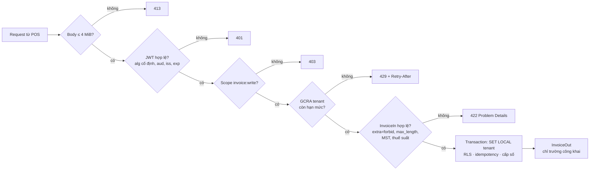

# Module 11 — Bảo mật API

> Thời lượng: ~55 phút · Mức độ: Trung bình → Nâng cao · Tiên quyết: Module 07, 08, 10

`invoice-api` giữ hóa đơn của 3.000 doanh nghiệp: tên khách hàng, mã số thuế, doanh thu. Đó là dữ liệu mà đối thủ cạnh tranh, kẻ lừa đảo và cơ quan thuế đều quan tâm, mỗi bên vì lý do riêng. `ai-gateway` nhận email khách hàng (có PII) và gọi LLM bằng khóa API trả tiền theo token. Module này trả lời câu hỏi: **ai được làm gì, với dữ liệu nào, bao nhiêu lần**, và làm sao để mỗi câu trả lời được **thực thi bằng code** chứ không chỉ nằm trên giấy.

Module không nhằm liệt kê mọi lỗ hổng. Nó đi theo **OWASP API Security Top 10 (2023)** và với mỗi rủi ro chính chỉ ra **cơ chế cụ thể** trong Pydantic, FastAPI hoặc database dùng để chặn nó. Kèm theo là một thí nghiệm chạy thật cho thấy điều gì xảy ra khi không chặn. Số đo trong `scripts/bench/bench_security.py`, chạy trên máy 4 vCPU, PyJWT 2.15, argon2-cffi 25.1, Redis 7.

## Mục tiêu học tập

Sau module này, bạn có thể:

1. Lập **mô hình đe dọa** cho một API: vẽ luồng dữ liệu, xác định ranh giới tin cậy, áp STRIDE.
2. Chọn cơ chế xác thực phù hợp (OAuth 2.0/2.1 client credentials, authorization code + PKCE, API key) theo **RFC 9700**, và kiểm JWT đúng theo **RFC 8725**. Giải thích bằng thí nghiệm các lỗi `alg=none`, nhầm thuật toán, thiếu `aud`/`exp`.
3. Lưu mật khẩu bằng **Argon2id** với tham số OWASP và tính **chi phí brute-force** cho từng loại hàm băm.
4. Chặn **BOLA, BOPLA/mass assignment, BFLA** bằng tổ hợp: truy vấn có `tenant_id`, model Pydantic vào/ra riêng (`extra="forbid"`), và `Security(..., scopes=...)`.
5. Thiết kế **rate limiting** theo tenant bằng GCRA/token bucket (toán và cài đặt trên Redis), và đặt giới hạn tài nguyên chống **DoS qua payload**.
6. Cấu hình **CORS** đúng, chặn **SSRF** cho URL webhook, và quản lý **bí mật**.

---

## 1. Mô hình đe dọa trước, công cụ sau

### 1.1. Luồng dữ liệu và ranh giới tin cậy

Câu hỏi "API có an toàn không?" không có câu trả lời. Câu hỏi đúng là "**ai** có thể làm **gì** sai, ở **đâu**". Kỹ thuật cơ bản gồm hai bước:

1. Vẽ **sơ đồ luồng dữ liệu** (DFD).
2. Đánh dấu **ranh giới tin cậy** (trust boundary): mọi chỗ dữ liệu đi từ vùng ít tin cậy sang vùng tin cậy hơn.

Mọi ranh giới đều phải có kiểm tra.

<!-- placeholder-threat -->

<!-- fig:threat -->
<figure markdown="span">
  { loading=lazy }
  { loading=lazy }
  <figcaption>Hình 11.1 — Sơ đồ luồng dữ liệu của Mekong Cloud với các ranh giới tin cậy và đe dọa STRIDE tương ứng.</figcaption>
</figure>
<!-- /fig -->

Với mỗi ranh giới, đi qua sáu loại đe dọa của **STRIDE**. Mô hình này do Kohnfelder và Garg đề xuất ở Microsoft năm 1999, và ngày nay vẫn là khung phổ biến nhất:

| STRIDE | Tính chất bị vi phạm | Ví dụ ở `invoice-api` | Cơ chế chặn (module) |
|---|---|---|---|
| **S**poofing — giả mạo danh tính | xác thực | dùng token của POS khác | JWT có chữ ký, kiểm `aud`/`iss`/`exp` (M11) |
| **T**ampering — sửa dữ liệu | toàn vẹn | sửa `total` của hóa đơn đã ký | model Patch không có `total`; hóa đơn ký rồi bất biến (M04, M11) |
| **R**epudiation — chối bỏ | không chối bỏ | "tôi không hủy hóa đơn đó" | log kiểm toán có `sub`, `tenant`, request id (M13) |
| **I**nformation disclosure — lộ thông tin | bảo mật | đọc hóa đơn tenant khác (BOLA) | `WHERE tenant_id`, RLS, `InvoiceOut` (M10, M11) |
| **D**enial of service — từ chối dịch vụ | sẵn sàng | gửi body 24 MB, JSON sâu 100.000 tầng | giới hạn body, độ sâu, rate limit (M11) |
| **E**levation of privilege — leo thang quyền | phân quyền | POS gọi endpoint hủy hóa đơn | `Security(scopes=...)` (M08, M11) |

### 1.2. OWASP API Security Top 10 (2023)

OWASP tổng kết các rủi ro phổ biến nhất **riêng cho API**. Đây là bản thứ hai, sau bản 2019. Năm trong mười rủi ro là **lỗi phân quyền và lỗi tiêu thụ tài nguyên**, không phải lỗi "kỹ thuật" như injection. Điều đó phản ánh một thực tế: API hiện đại ít khi bị SQL injection (vì ORM và tham số hóa), nhưng rất hay **trả dữ liệu cho sai người**.

<!-- placeholder-owasp -->

<!-- fig:owasp -->
<figure markdown="span">
  { loading=lazy }
  { loading=lazy }
  <figcaption>Hình 11.2 — OWASP API Security Top 10 (2023) và cơ chế chặn từng rủi ro trong khóa học.</figcaption>
</figure>
<!-- /fig -->

| # | Rủi ro | Một câu | Mục |
|---|---|---|---|
| API1 | Broken Object Level Authorization (BOLA) | đổi `id` trong URL là đọc được đối tượng của người khác | 4.1 |
| API2 | Broken Authentication | token giả, token hết hạn vẫn dùng được, brute-force mật khẩu | 2, 3 |
| API3 | Broken Object Property Level Authorization (BOPLA) | lộ trường nhạy cảm, hoặc ghi được trường không được phép (mass assignment) | 4.2 |
| API4 | Unrestricted Resource Consumption | không giới hạn kích thước, tần suất, chi phí | 5, 6 |
| API5 | Broken Function Level Authorization (BFLA) | người dùng thường gọi được chức năng quản trị | 4.3 |
| API6 | Unrestricted Access to Sensitive Business Flows | lạm dụng luồng nghiệp vụ hợp lệ (vd: tạo hàng loạt hóa đơn nháp) | 5 |
| API7 | Server Side Request Forgery (SSRF) | server bị lừa gọi tới địa chỉ nội bộ | 7.2 |
| API8 | Security Misconfiguration | CORS sai, lộ stack trace, thiếu header | 7.1 |
| API9 | Improper Inventory Management | endpoint cũ, bản v1 quên tắt, docs lộ ra internet | M13 |
| API10 | Unsafe Consumption of APIs | tin dữ liệu từ API bên thứ ba (hoặc từ LLM) mà không kiểm tra | M15 |

---

## 2. Xác thực: ai đang gọi?

### 2.1. Ba loại client, ba cơ chế

| Client | Ví dụ | Cơ chế khuyến nghị | Lý do |
|---|---|---|---|
| Máy với máy | 12.000 máy POS/ERP gọi `invoice-api` | **OAuth 2.0 client credentials** → access token ngắn hạn (JWT); hoặc **API key** nếu đối tác không hỗ trợ OAuth | không có người dùng; bí mật nằm trên máy |
| Người dùng qua trình duyệt | ~60 nhân viên CS dùng UI của `ai-gateway` | **Authorization code + PKCE** qua IdP (OIDC), phiên bằng cookie `HttpOnly; Secure; SameSite` | không để token trong JavaScript (chống XSS lấy token) |
| Dịch vụ nội bộ | `ai-gateway` gọi `invoice-api` | client credentials hoặc **mTLS** (RFC 8705) / workload identity của nền tảng | không có bí mật dài hạn trong mã |

**RFC 9700** (*Best Current Practice for OAuth 2.0 Security*, 01/2025) gom các bài học sau một thập kỷ triển khai OAuth 2.0. Những điểm quan trọng nhất cho người viết API:

- Bỏ **implicit grant** và **resource owner password credentials grant**.
- Mọi authorization code flow đều dùng **PKCE** (RFC 7636), kể cả client có bí mật.
- **Access token phải bị giới hạn**: theo audience (chỉ dùng được cho đúng resource server), theo scope (quyền tối thiểu), và nên **ràng buộc vào người gửi** (sender-constrained, bằng mTLS hoặc DPoP — RFC 9449) để token bị lộ không dùng lại được ở nơi khác.
- **Refresh token** của client công khai phải được xoay vòng (rotation) hoặc ràng buộc vào người gửi.

**OAuth 2.1** (Internet-Draft của IETF, chưa thành RFC tính đến 10/2026) hợp nhất OAuth 2.0 với các BCP này thành một tài liệu.

<!-- placeholder-oauth -->

<!-- fig:oauth -->
<figure markdown="span">
  { loading=lazy }
  { loading=lazy }
  <figcaption>Hình 11.3 — Hai luồng OAuth: client credentials cho máy POS, authorization code + PKCE cho nhân viên qua trình duyệt.</figcaption>
</figure>
<!-- /fig -->

### 2.2. JWT: cấu trúc và những gì phải kiểm

Một JWT (RFC 7519) gồm `header.payload.signature`, mỗi phần mã hóa base64url. **Header và payload không được mã hóa**: ai cầm token cũng đọc được. Chữ ký chỉ chứng minh rằng **nội dung chưa bị sửa từ khi được ký bởi người giữ khóa**. Nó không nói gì về việc token dành cho ai, còn hạn không, hay ai đang cầm nó.

<!-- placeholder-jwt -->

<!-- fig:jwt -->
<figure markdown="span">
  { loading=lazy }
  { loading=lazy }
  <figcaption>Hình 11.4 — Cấu trúc JWT và bốn bước kiểm tra bắt buộc ở resource server.</figcaption>
</figure>
<!-- /fig -->

**RFC 8725** (*JSON Web Token Best Current Practices*, 2020) liệt kê những gì resource server **phải** làm:

1. **Cố định danh sách thuật toán** phía server. Không bao giờ đọc thuật toán từ header rồi làm theo.
2. Kiểm **`exp`** (hết hạn), **`nbf`**, **`iss`** (ai phát hành), **`aud`** (token này cho ai).
3. Dùng khóa đúng loại cho đúng thuật toán: khóa công khai RSA/EC/Ed25519 không bao giờ được dùng làm bí mật HMAC.
4. Phân biệt các loại JWT khác nhau (access token, ID token…) bằng `typ` hoặc `aud` riêng, để một loại không bị dùng thay cho loại kia.

### 2.3. Thí nghiệm: decoder tự viết và PyJWT

Thí nghiệm `s2` so một decoder "tự viết" (đọc `alg` từ header rồi làm theo, kiểu code vẫn gặp trong các dự án nội bộ) với PyJWT dùng đúng cách:

| Tấn công | Decoder tự viết | PyJWT (`algorithms=["RS256"]`, `audience=...`) |
|---|---|---|
| `alg: none`, không chữ ký, `scope: admin` | **CHẤP NHẬN** | từ chối: `InvalidAlgorithmError` |
| **Nhầm thuật toán**: ký HS256 bằng **khóa công khai** RSA | **CHẤP NHẬN** | từ chối: `InvalidAlgorithmError` |
| Như trên, server lỡ cho phép `["RS256", "HS256"]` | **CHẤP NHẬN** | từ chối: `InvalidKeyError: The specified key is an asymmetric key … should not be used as an HMAC secret` |
| Token hợp lệ nhưng cho dịch vụ khác (`aud: ai-gateway`) | **CHẤP NHẬN** | từ chối: `InvalidAudienceError` |
| Token hết hạn 1 giờ | **CHẤP NHẬN** (tắt kiểm `exp` "cho dễ test") | từ chối: `ExpiredSignatureError` |

<!-- placeholder-jwt-attacks -->

<!-- fig:jwt-attacks -->
<figure markdown="span">
  { loading=lazy }
  { loading=lazy }
  <figcaption>Hình 11.5 — Số đo thật: năm token tấn công qua decoder tự viết và PyJWT dùng đúng cách.</figcaption>
</figure>
<!-- /fig -->

**Tấn công nhầm thuật toán** (algorithm confusion) đáng hiểu kỹ. Server kiểm token RS256 bằng khóa **công khai**, mà khóa công khai thì ai cũng lấy được (thường công bố qua JWKS). Kẻ tấn công tạo token với header `alg: HS256` và **ký HMAC bằng chính chuỗi khóa công khai đó**. Một decoder làm theo header sẽ gọi `HMAC(public_key_bytes, …)`, và chữ ký khớp. Lỗi này đã xuất hiện trong nhiều thư viện thật, ví dụ **CVE-2022-29217** của PyJWT (trước 2.4.0) khi ứng dụng cho phép mọi thuật toán. PyJWT hiện chặn ở hai lớp: danh sách `algorithms` cố định, và từ chối dùng khóa bất đối xứng làm bí mật HMAC.

### 2.4. Cài đặt: dependency xác thực

Ghép JWT với Pydantic và DI (Module 08). Claims được **validate như mọi input khác**:

```python
from typing import Annotated

import jwt
from fastapi import Depends, HTTPException, Security, status
from fastapi.security import HTTPAuthorizationCredentials, HTTPBearer, SecurityScopes
from pydantic import BaseModel, ConfigDict, Field, ValidationError, field_validator


class Principal(BaseModel):
    model_config = ConfigDict(frozen=True)
    sub: str
    tenant_id: int = Field(alias="tid", gt=0)
    scopes: frozenset[str] = Field(alias="scope")

    @field_validator("scopes", mode="before")
    @classmethod
    def split_scope(cls, v: str) -> frozenset[str]:   # claim "scope" là chuỗi cách nhau bởi dấu cách
        return frozenset(v.split())


bearer = HTTPBearer(auto_error=False)


async def current_principal(
    security_scopes: SecurityScopes,
    cred: Annotated[HTTPAuthorizationCredentials | None, Depends(bearer)],
) -> Principal:
    unauthorized = HTTPException(status.HTTP_401_UNAUTHORIZED, "token không hợp lệ",
                                 headers={"WWW-Authenticate": "Bearer"})
    if cred is None:
        raise unauthorized
    try:
        claims = jwt.decode(cred.credentials, PUBLIC_KEY,
                            algorithms=["EdDSA"],                    # danh sách CỐ ĐỊNH
                            audience="invoice-api", issuer="https://id.mekong.vn",
                            options={"require": ["exp", "iat", "sub", "aud", "iss"]},
                            leeway=30)                               # lệch đồng hồ tối đa 30 s
        p = Principal.model_validate(claims)
    except (jwt.PyJWTError, ValidationError):
        raise unauthorized from None                                 # không lộ lý do chi tiết ra ngoài
    missing = set(security_scopes.scopes) - p.scopes
    if missing:
        raise HTTPException(status.HTTP_403_FORBIDDEN, f"thiếu scope: {' '.join(sorted(missing))}")
    return p
```

Chạy thật với một bộ request:

```text
không token              401 {"detail":"token không hợp lệ"}
hóa đơn của mình         200 {"id":101,"tenant_id":7,"total":55000}
hóa đơn tenant khác      404 {"detail":"không tìm thấy"}
thiếu scope cancel       403 {"detail":"thiếu scope: invoice:cancel"}
thiếu claim exp          401 {"detail":"token không hợp lệ"}
tid = 0                  401 {"detail":"token không hợp lệ"}       ← Pydantic chặn claim sai kiểu/miền
```

Phân biệt **401** và **403**: 401 nghĩa là "tôi không biết bạn là ai" (thiếu token hoặc token sai), và phải kèm `WWW-Authenticate`. 403 nghĩa là "tôi biết bạn là ai, nhưng bạn không được làm việc này".

### 2.5. Chi phí kiểm token

Mỗi request đều kiểm chữ ký, nên chi phí đó cộng thẳng vào latency (thí nghiệm `s1`):

| Thuật toán | Ký | **Kiểm** | Kích thước token |
|---|---|---|---|
| HS256 | 22 µs | **39 µs** | 235 byte |
| RS256 (2048 bit) | 373 µs | **82 µs** | 534 byte |
| ES256 | 42 µs | **111 µs** | 278 byte |
| EdDSA (Ed25519) | 43 µs | **137 µs** | 278 byte |

<!-- placeholder-jwt-cost -->

<!-- fig:jwt-cost -->
<figure markdown="span">
  { loading=lazy }
  { loading=lazy }
  <figcaption>Hình 11.6 — Số đo thật: chi phí ký và kiểm JWT theo thuật toán.</figcaption>
</figure>
<!-- /fig -->

Ở 500 req/s, 137 µs mỗi request là ~7% của một core. Chi phí này đáng kể nhưng không phải nút thắt (Module 09 đo ~0,5 ms CPU mỗi request cho HTTP + FastAPI). **HS256 nhanh nhất nhưng là khóa đối xứng**: mọi dịch vụ kiểm token cũng **ký được** token. Với một IdP phục vụ nhiều dịch vụ, dùng thuật toán bất đối xứng (EdDSA hoặc ES256 cho token ngắn; RS256 nếu cần tương thích rộng) để chỉ IdP giữ khóa bí mật.

Mẹo vận hành: **cache khóa công khai theo `kid`** từ endpoint JWKS của IdP và làm mới khi gặp `kid` lạ. Không gọi JWKS mỗi request. Cũng không **cache kết quả kiểm token** theo chuỗi token: tiết kiệm được 100 µs nhưng tạo thêm một nơi phải xử lý thu hồi và hết hạn.

### 2.6. API key cho máy

Không phải đối tác nào cũng tích hợp được OAuth. Với API key, ba quy tắc:

1. **Định dạng có tiền tố**, ví dụ `mk_live_7Hq2…`: nhìn là biết của ai, môi trường nào, và các công cụ quét bí mật (GitHub secret scanning) nhận diện được khi key bị đẩy lên repo công khai.
2. **Chỉ lưu hash.** Với key ngẫu nhiên 256 bit, **SHA-256 là đủ**. Không cần Argon2, vì không gian key quá lớn để brute-force, khác hẳn mật khẩu do người đặt (mục 3). Tra cứu bằng hash, so sánh bằng `hmac.compare_digest`.
3. Key gắn với **tenant và scope**. Dependency biến key thành cùng một `Principal` như JWT, để phần còn lại của app không cần biết client xác thực bằng cách nào.

---

## 3. Mật khẩu: Argon2id và toán brute-force

### 3.1. Vì sao không dùng SHA-256 cho mật khẩu

Khi database bị lộ, kẻ tấn công có bảng hash và thử đoán **offline**, không có rate limit nào ngăn được. Tốc độ đoán do **hàm băm** quyết định. Mục tiêu của hàm băm mật khẩu ngược với mọi hàm băm khác: **càng chậm và càng tốn bộ nhớ càng tốt**, trong giới hạn server chấp nhận được.

Số đo trên máy đo (một lần băm, một core):

| Hàm | Thời gian | Bộ nhớ |
|---|---|---|
| SHA-256 | 0,0007 ms | — |
| PBKDF2-SHA256 600.000 vòng (OWASP) | 369 ms | — |
| bcrypt cost 10 (OWASP tối thiểu) | 68 ms | 4 KiB |
| bcrypt cost 12 | 276 ms | 4 KiB |
| **Argon2id m = 19 MiB, t = 2, p = 1 (OWASP)** | **36 ms** | 19 MiB |
| Argon2id m = 46 MiB, t = 1, p = 1 (OWASP) | 70 ms | 46 MiB |
| Argon2id m = 64 MiB, t = 3, p = 4 (RFC 9106) | 231 ms | 64 MiB |

<!-- placeholder-hash -->

<!-- fig:hash -->
<figure markdown="span">
  { loading=lazy }
  { loading=lazy }
  <figcaption>Hình 11.7 — Số đo thật: chi phí một lần băm theo hàm; và ước lượng thời gian phá mật khẩu 8 ký tự.</figcaption>
</figure>
<!-- /fig -->

**Argon2id** (RFC 9106, thắng Password Hashing Competition 2015) là lựa chọn mặc định của OWASP. Lý do là nó **memory-hard**: mỗi lần thử phải dùng 19 MiB RAM. Một GPU có hàng nghìn lõi nhưng bộ nhớ có hạn, và băng thông bộ nhớ, chứ không phải số lõi, trở thành giới hạn. Vì vậy lợi thế song song của GPU/ASIC bị triệt tiêu phần lớn. SHA-256 thì ngược lại: một GPU RTX 4090 băm khoảng **21,8 tỷ SHA-256 mỗi giây** (benchmark `hashcat -m 1400` công bố trên diễn đàn hashcat, 2023).

### 3.2. Toán brute-force

Thời gian kỳ vọng để tìm một mật khẩu là **nửa không gian tìm kiếm chia cho tốc độ thử**:

$$
T = \frac{|\Sigma|^{L} / 2}{R}
$$

Ước lượng (giả định: SHA-256 trên 1 GPU RTX 4090; bcrypt/Argon2id trên 1.000 core CPU thuê cloud, tốc độ mỗi core lấy từ số đo trên):

| Không gian mật khẩu | Kích thước | SHA-256, 1 GPU | bcrypt-10, 1.000 core | Argon2id 19 MiB, 1.000 core |
|---|---|---|---|---|
| top 10.000 mật khẩu phổ biến | $10^4$ | 0,0002 ms | 0,34 s | 0,18 s |
| 8 ký tự `a-z0-9` | $2{,}8 \times 10^{12}$ | **65 s** | 3,1 năm | 1,6 năm |
| 4 từ ngẫu nhiên (diceware, 7.776 từ) | $3{,}7 \times 10^{15}$ | 23 giờ | ~4.000 năm | ~2.100 năm |
| 12 ký tự `a-zA-Z0-9` | $3{,}2 \times 10^{21}$ | ~2.300 năm | $3 \times 10^{9}$ năm | $2 \times 10^{9}$ năm |

Hai kết luận:

1. **Hàm băm chậm biến "65 giây" thành "vài năm"** cho cùng một mật khẩu trung bình, tức nhân chi phí của kẻ tấn công lên khoảng $10^6$ lần.
2. **Không hàm băm nào cứu được mật khẩu phổ biến**: dưới 1 giây cho cả danh sách top 10.000. Vì vậy NIST SP 800-63B yêu cầu **so mật khẩu mới với danh sách mật khẩu đã lộ** khi người dùng đặt mật khẩu, và ưu tiên độ dài hơn quy tắc ký tự phức tạp.

### 3.3. Cài đặt trong FastAPI: đừng chặn event loop

Argon2id tốn 36 ms CPU. Gọi nó trực tiếp trong `async def` sẽ chặn event loop 36 ms mỗi lần đăng nhập (Module 09: một request chặn loop làm chậm **mọi** request khác). Tin tốt là argon2-cffi và bcrypt **nhả GIL** khi băm (thí nghiệm `s8`):

| Hàm | 1 luồng | 2 luồng | 4 luồng |
|---|---|---|---|
| Argon2id 19 MiB | 36 lần/s | 73 lần/s | 119 lần/s |
| bcrypt cost 10 | 13 lần/s | 28 lần/s | 52 lần/s |

```python
from argon2 import PasswordHasher
from argon2.exceptions import VerifyMismatchError
from fastapi.concurrency import run_in_threadpool

ph = PasswordHasher(time_cost=2, memory_cost=19 * 1024, parallelism=1)   # OWASP: m=19 MiB, t=2, p=1


async def verify_password(stored_hash: str, password: str) -> bool:
    try:
        await run_in_threadpool(ph.verify, stored_hash, password)          # chạy trong threadpool, nhả GIL
    except VerifyMismatchError:
        return False
    return True
    # sau khi đúng: ph.check_needs_rehash(stored_hash) → băm lại với tham số mới khi đã tăng chi phí
```

Một hệ quả về DoS: mỗi lần thử đăng nhập tốn 36 ms CPU **của server**, nên kẻ tấn công gửi 100 lần thử/s là chiếm 3,6 core. Endpoint đăng nhập phải được **rate limit trước khi băm** (theo IP và theo tài khoản), không phải sau.

---

## 4. Phân quyền: ba lỗi đứng đầu OWASP

Xác thực trả lời "bạn là ai". Phân quyền trả lời "bạn được làm gì **với đối tượng này**, **với trường này**, **với chức năng này**". Ba câu hỏi đó ứng với ba mục OWASP: BOLA, BOPLA, BFLA.

### 4.1. BOLA: đối tượng của ai?

**Broken Object Level Authorization** là rủi ro số 1. Kịch bản: POS của tenant 7 gọi `GET /v1/invoices/101` hợp lệ, rồi thử `102`, `103`… Nếu server chỉ kiểm "token hợp lệ" mà không kiểm "hóa đơn này thuộc tenant của token", mọi hóa đơn của 3.000 doanh nghiệp đều đọc được.

Case công khai: năm 2021, Pen Test Partners phát hiện API của Peloton trả dữ liệu tài khoản (tuổi, giới tính, cân nặng, thống kê tập luyện, kể cả của hồ sơ đặt chế độ riêng tư) cho request **không xác thực**. Lần sửa đầu tiên chỉ yêu cầu đăng nhập, nên dữ liệu vẫn lộ cho **mọi tài khoản đã đăng nhập**: xác thực đã được thêm, nhưng phân quyền theo đối tượng thì chưa (TechCrunch, 05/2021).

<!-- placeholder-bola -->

<!-- fig:bola -->
<figure markdown="span">
  { loading=lazy }
  { loading=lazy }
  <figcaption>Hình 11.8 — BOLA: truy vấn không gắn tenant làm lộ hóa đơn; gắn tenant từ principal trả 404.</figcaption>
</figure>
<!-- /fig -->

Phòng thủ nhiều lớp cho `invoice-api`:

1. **Mọi truy vấn có `tenant_id` lấy từ `Principal`**, không bao giờ từ request body hay query. Repository nhận `tenant_id` lúc khởi tạo (dependency `invoice_repo`, Module 08), nên không có phương thức nào truy vấn mà thiếu nó.
2. **RLS** ở database (Module 10) là lưới an toàn cho lần quên duy nhất.
3. Trả **404**, không phải 403, khi đối tượng thuộc tenant khác. 403 xác nhận "hóa đơn 102 tồn tại", và chừng đó đã đủ để dò xem đối thủ phát hành bao nhiêu hóa đơn.
4. **ID không đoán được** (UUIDv7 hoặc UUIDv4) cho tài nguyên công khai. Đây chỉ là **giảm thiểu**, không phải phân quyền: ID lộ qua log, email, URL được chia sẻ. Đừng bao giờ dựa vào "ID khó đoán" thay cho kiểm quyền.

Kiểm tra trong test: với **mỗi** endpoint có ID trong path, viết test "tenant A truy cập đối tượng của tenant B → 404". Module 12 tự động hóa việc này bằng fuzz theo schema.

### 4.2. BOPLA: trường nào được đọc, trường nào được ghi?

**Broken Object Property Level Authorization** gộp hai lỗi cũ: **lộ dữ liệu quá mức** (trả về trường không nên trả) và **mass assignment** (ghi được trường không nên ghi). Cả hai đều chặn được bằng một nguyên tắc: **model Pydantic riêng cho từng hướng và từng thao tác**.

Thí nghiệm `s7`: client gửi `PATCH /v1/invoices/101` với body

```json
{"buyer_name": "Cty A (sửa)", "status": "signed", "tenant_id": 1, "total": 0}
```

| Cách xử lý | Kết quả trên đối tượng hóa đơn |
|---|---|
| Ngây thơ: `for k, v in body.items(): setattr(inv, k, v)` | `tenant_id = 1` (**chuyển hóa đơn sang tenant khác**), `status = 'signed'` (**bỏ qua quy trình ký**), `total = 0` |
| `InvoicePatch` chỉ có `buyer_name`, `extra` mặc định (`"ignore"`) | chỉ `buyer_name` đổi; các trường khác bị **lặng lẽ bỏ qua** |
| `InvoicePatch` với `extra="forbid"` | **422**: `status`, `tenant_id`, `total` → `extra_forbidden` |

<!-- placeholder-bopla -->

<!-- fig:bopla -->
<figure markdown="span">
  { loading=lazy }
  { loading=lazy }
  <figcaption>Hình 11.9 — Số đo thật: cùng một body PATCH độc hại qua ba cách xử lý.</figcaption>
</figure>
<!-- /fig -->

```python
from pydantic import BaseModel, ConfigDict


class InvoicePatch(BaseModel):
    model_config = ConfigDict(extra="forbid")      # gửi trường lạ → 422, không lặng lẽ bỏ qua
    buyer_name: str | None = None
    buyer_email: str | None = None


@app.patch("/v1/invoices/{invoice_id}")
async def patch_invoice(invoice_id: UUID, body: InvoicePatch, repo: InvoiceRepo) -> InvoiceOut:
    inv = await repo.get(invoice_id)                                   # đã lọc theo tenant → 404 nếu không phải của mình
    for k, v in body.model_dump(exclude_unset=True).items():          # chỉ trường client THỰC SỰ gửi
        setattr(inv, k, v)
    return InvoiceOut.model_validate(inv)
```

Chọn `"forbid"` hay `"ignore"`? Với API ghi, `"forbid"` tốt hơn: client gửi nhầm `"buyer_nme"` sẽ nhận lỗi rõ ràng thay vì tưởng đã sửa thành công. Cái giá là khó tiến hóa hơn: thêm trường mới ở client trước khi server hỗ trợ sẽ bị 422. Ở chiều ra, `InvoiceOut` liệt kê **đúng** những trường được trả, và `response_model` của FastAPI lọc mọi thứ khác (Module 07), nên `tenant_id` hay `signed_xml` không bao giờ lọt ra ngoài.

### 4.3. BFLA: chức năng nào được gọi?

**Broken Function Level Authorization** là khi máy POS gọi được `POST /v1/invoices/{id}/cancel`, một chức năng chỉ dành cho kế toán. Cơ chế của FastAPI: `Security(dependency, scopes=[...])` khai báo quyền **ngay trên chữ ký endpoint**, và scope hiện trong OpenAPI:

```python
@app.post("/v1/invoices/{invoice_id}/cancel")
async def cancel_invoice(
    invoice_id: UUID,
    p: Annotated[Principal, Security(current_principal, scopes=["invoice:cancel"])],
): ...
```

Hai thói quen giúp BFLA không lọt:

- **Mặc định từ chối.** Router quản trị khai báo `dependencies=[Security(current_principal, scopes=["admin"])]` ở cấp `APIRouter`, để endpoint mới thêm vào tự động được bảo vệ.
- **Test bằng ma trận** (vai trò × endpoint → mã trạng thái mong đợi), sinh tự động từ danh sách route của app.

---

## 5. Rate limiting: bao nhiêu lần?

### 5.1. Vì sao cần, và giới hạn theo cái gì

Rate limit bảo vệ ba thứ:

- **Tài nguyên**: API4. Một tenant gửi 10.000 req/s làm chậm 2.999 tenant còn lại.
- **Luồng nghiệp vụ**: API6. Thử 1 triệu mật khẩu, tạo hàng loạt hóa đơn nháp.
- **Chi phí**: mỗi lượt `ai-gateway` gọi LLM tốn tiền thật.

Giới hạn theo **tenant** (từ `Principal`), không theo IP: 12.000 máy POS có thể đứng sau vài NAT, và một tenant có thể dùng hàng trăm IP.

### 5.2. Toán: cửa sổ cố định và token bucket / GCRA

**Cửa sổ cố định** đếm số request trong mỗi giây lịch rồi chặn khi vượt ngưỡng. Nó đơn giản nhưng có lỗi ở **ranh giới cửa sổ**: client gửi 10 request ở cuối giây 0 và 10 request ở đầu giây 1, cả 20 đều qua, tức **gấp đôi** giới hạn trong 0,2 giây.

**Token bucket** có xô dung tích $b$ (burst) được rót $r$ token mỗi giây, và mỗi request lấy 1 token. Tính chất quan trọng: trong **mọi** khoảng thời gian dài $t$,

$$
\text{số request được nhận} \le b + r \cdot t
$$

**GCRA** (Generic Cell Rate Algorithm, có nguồn gốc từ mạng ATM) tương đương toán học với token bucket nhưng chỉ lưu **một số** cho mỗi khóa: thời điểm đến lý thuyết $\mathrm{TAT}$. Với $T = 1/r$ và dung sai $\tau = (b-1)\,T$, một request đến lúc $t$ được xử lý như sau:

$$
\mathrm{TAT}' = \max(\mathrm{TAT}, t); \quad \text{nhận nếu } \mathrm{TAT}' - t \le \tau, \text{ khi đó } \mathrm{TAT} \leftarrow \mathrm{TAT}' + T
$$

Mô phỏng (thí nghiệm `s3`, giới hạn 10 req/s, burst 10) với đúng kịch bản ranh giới: trong 0,2 giây quanh mốc 1 s, cửa sổ cố định cho qua **20** request, GCRA cho qua **10**.

<!-- placeholder-ratelimit -->

<!-- fig:ratelimit -->
<figure markdown="span">
  { loading=lazy }
  { loading=lazy }
  <figcaption>Hình 11.10 — Mô phỏng: cửa sổ cố định để lọt gấp đôi giới hạn quanh ranh giới, GCRA thì không.</figcaption>
</figure>
<!-- /fig -->

### 5.3. Cài đặt trên Redis

Với nhiều pod, trạng thái rate limit phải nằm ở chỗ dùng chung. GCRA trên Redis chỉ cần một script Lua (nguyên tử, dùng đồng hồ của Redis để tránh lệch giờ giữa các pod):

```lua
-- KEYS[1] = rl:tenant:<id>   ARGV[1] = T = 1/rate   ARGV[2] = tau = (burst-1)*T
local t = redis.call('TIME'); local now = tonumber(t[1]) + tonumber(t[2]) / 1e6
local tat = tonumber(redis.call('GET', KEYS[1]) or now)
if tat < now then tat = now end
if tat - now > tonumber(ARGV[2]) then return 0 end            -- từ chối → 429 + Retry-After
redis.call('SET', KEYS[1], tat + tonumber(ARGV[1]), 'PX', math.ceil((tat + tonumber(ARGV[1]) - now) * 1000) + 1000)
return 1
```

Chạy thật: giới hạn 100 req/s, burst 20, **50 client đồng thời** dồn dập trong 3 giây. Kết quả: 28.441 lần thử (9.478 lần kiểm tra/s từ một tiến trình Python), **314 lần được nhận**, trong khi trần lý thuyết $b + r t = 20 + 100 \times 3 = 320$. Giới hạn được giữ đúng dưới tranh chấp. Một lần kiểm tra không tranh chấp tốn p50 **133 µs**, p99 283 µs (một round trip tới Redis), nhỏ so với ngân sách 300 ms.

Ba quyết định vận hành:

- Trả **`429 Too Many Requests`** kèm `Retry-After` (giây, từ $\mathrm{TAT} - \tau - t$), và nên có thêm header `RateLimit` / `RateLimit-Policy` theo Internet-Draft của nhóm httpapi IETF, để client biết còn bao nhiêu.
- **Redis sập thì sao?** Với `invoice-api`, chọn **fail open** (cho qua và ghi log) vì không tạo được hóa đơn còn tệ hơn bị lạm dụng ngắn hạn. Với endpoint đăng nhập, chọn **fail closed**.
- **Giới hạn theo chi phí, không chỉ theo số lần**: batch 500 hóa đơn tiêu 500 token chứ không phải 1. Ở `ai-gateway`, giới hạn theo **số token LLM** mỗi tenant mỗi giờ.

---

## 6. DoS qua payload: giới hạn mọi thứ có thể lớn

Một request nhỏ về số lượng vẫn có thể rất đắt về tài nguyên. Pydantic và FastAPI có sẵn vài giới hạn, nhưng không phải tất cả.

### 6.1. Độ sâu JSON

| Độ sâu `[[[…]]]` | `model_validate_json` (jiter) | `json.loads` (FastAPI dùng) |
|---|---|---|
| 200 | ok | ok |
| 1.000 | **từ chối**: `recursion limit exceeded` | ok |
| 100.000 | từ chối | **`RecursionError`** |

Parser jiter của pydantic-core có **giới hạn đệ quy ~200 tầng**, đủ cho mọi dữ liệu hợp lý và chặn được JSON bệnh hoạn. `json.loads` của thư viện chuẩn thì đi sâu tới giới hạn đệ quy của Python. Ở độ sâu 100.000, nó ném `RecursionError`, một ngoại lệ không phải lỗi JSON, nên nếu không có handler thì thành 500. Đây là một lý do nữa để đọc body thô và gọi `model_validate_json` (Module 06).

### 6.2. Kích thước danh sách và body

`lines: Annotated[list[Line], Field(max_length=500)]` chặn hóa đơn quá 500 dòng. Nhưng **chi phí từ chối vẫn tăng theo kích thước input**, vì JSON phải được phân tích hết:

| Số dòng | Kích thước | Thời gian `model_validate_json` |
|---|---|---|
| 500 | 0,02 MB | 0,3 ms (nhận) |
| 5.000 | 0,24 MB | 5,1 ms (từ chối) |
| 50.000 | 2,35 MB | 68 ms (từ chối) |
| 200.000 | 9,4 MB | 325 ms (từ chối) |

Và qua FastAPI, với body 24 MB (500.000 dòng):

| Cấu hình | Kết quả | Thời gian | Đỉnh bộ nhớ Python |
|---|---|---|---|
| không giới hạn | 422 (vì `max_length`) | **2.615 ms** | **296 MiB** |
| `RequestBodyLimitMiddleware(max_body_size=1 MiB)` | **413** | **0,6 ms** | ~0 (không đọc chunk nào) |

<!-- placeholder-payload -->

<!-- fig:payload -->
<figure markdown="span">
  { loading=lazy }
  { loading=lazy }
  <figcaption>Hình 11.11 — Số đo thật: chi phí từ chối tăng theo kích thước input; giới hạn body trả 413 gần như miễn phí.</figcaption>
</figure>
<!-- /fig -->

Không có giới hạn body, mỗi request 24 MB chiếm **2,6 giây CPU và 296 MiB RAM** trước khi bị từ chối. Mười request như vậy đồng thời là đủ làm một pod bị OOM-kill. Starlette 1.x có `RequestBodyLimitMiddleware`: nó kiểm `Content-Length` trước khi đọc, và đếm byte khi body được gửi kiểu chunked, nên từ chối với **413 Content Too Large** gần như miễn phí. Đặt giới hạn theo endpoint: `invoice-api` cần ~5 KB cho một hóa đơn và ~2,5 MB cho batch 500 hóa đơn, nên 4 MiB là dư.

Bảng giới hạn đầy đủ cho `invoice-api`:

| Tài nguyên | Giới hạn | Cơ chế |
|---|---|---|
| Kích thước body | 4 MiB (batch), 64 KiB (còn lại) | `RequestBodyLimitMiddleware`, hoặc proxy (nginx `client_max_body_size`) |
| Độ sâu JSON | ~200 | jiter (dùng `model_validate_json`) |
| Số phần tử | 500 dòng/hóa đơn, 500 hóa đơn/batch | `Field(max_length=...)` |
| Độ dài chuỗi | tên hàng ≤ 500 ký tự | `Field(max_length=...)` / `StringConstraints` |
| Kích thước số | tiền ≤ $10^{15}$ VND | `Field(le=...)`. Python `int` không giới hạn kích thước. Số JSON dài hơn 4.300 chữ số bị cả jiter lẫn `json.loads` từ chối (giới hạn Python thêm sau CVE-2020-10735, đã chạy thử) |
| Tham số phân trang | `limit` ≤ 200 | `Query(le=200)` |
| Thời gian request | 10 s | timeout ở proxy + `asyncio.timeout` cho lời gọi ra ngoài (M13) |
| Tần suất | theo tenant | GCRA (mục 5) |

---

## 7. Cấu hình, SSRF và bí mật

### 7.1. CORS

CORS **không phải cơ chế bảo vệ API**. Nó là cách **trình duyệt** nới lỏng Same-Origin Policy cho những origin bạn chỉ định. Client không phải trình duyệt (curl, máy POS) bỏ qua CORS hoàn toàn. CORS chỉ quan trọng khi API dùng **cookie**: một trang độc hại mở trong trình duyệt của nhân viên CS có thể gửi request kèm cookie phiên của họ.

Thí nghiệm `s6`: request từ `Origin: https://evil.example`, kèm cookie, tới ba cấu hình `CORSMiddleware`:

| Cấu hình | `Access-Control-Allow-Origin` | `…-Allow-Credentials` | Hệ quả |
|---|---|---|---|
| `allow_origins=["*"]` | `*` | — | trình duyệt không gửi cookie kèm `*`; an toàn cho API công khai không dùng cookie |
| `allow_origins=["*"], allow_credentials=True` | **`https://evil.example`** | **`true`** | **nguy hiểm**: Starlette phản chiếu lại origin của request, và mọi trang web đều đọc được response có cookie |
| `allow_origins=["https://app.mekong.vn"], allow_credentials=True` | (không có) | `true` | đúng: origin lạ không được phép |

Cấu hình thứ hai là lỗi cấu hình kinh điển (API8). Theo đặc tả Fetch, trình duyệt từ chối `*` khi có credentials. Starlette "chiều" người dùng bằng cách phản chiếu origin, nên thực chất cho phép **mọi** origin gửi request có cookie. Quy tắc: có `allow_credentials=True` thì **liệt kê origin cụ thể**.

### 7.2. SSRF: URL webhook do người dùng nhập

`ai-gateway` cho tenant đăng ký **URL webhook** để nhận thông báo khi draft sẵn sàng. Server sẽ gửi request tới URL đó. Nếu tenant nhập `http://169.254.169.254/latest/meta-data/` (metadata service của cloud, nơi chứa credential tạm của máy), server sẽ tự đi lấy credential của chính nó. Đó là **SSRF** (API7). Đây cũng là con đường của vụ Capital One năm 2019.

Pydantic `HttpUrl` giải quyết được một phần quan trọng: nó **phân tích URL theo chuẩn WHATWG** và **chuẩn hóa host**. Thí nghiệm `s5` đưa vào các cách viết "lách" kinh điển:

| URL nhập vào | `HttpUrl(...).host` | Bộ lọc |
|---|---|---|
| `https://1.1.1.1/hook` | `1.1.1.1` | cho phép |
| `http://0x7f000001/` | `127.0.0.1` | chặn |
| `http://2130706433/` | `127.0.0.1` | chặn |
| `http://0177.0.0.1/` | `127.0.0.1` | chặn |
| `http://127.1/` | `127.0.0.1` | chặn |
| `http://[::ffff:127.0.0.1]/` | `[::ffff:7f00:1]` | chặn (IPv4-mapped) |
| `http://169.254.169.254/latest/meta-data/` | `169.254.169.254` | chặn |
| `http://evil.com@127.0.0.1/` | `127.0.0.1` | chặn |
| `http://127.0.0.1#@evil.com/` | `127.0.0.1` | chặn |
| `file:///etc/passwd`, `gopher://…` | — | `HttpUrl` từ chối scheme |

<!-- placeholder-ssrf -->

<!-- fig:ssrf -->
<figure markdown="span">
  { loading=lazy }
  { loading=lazy }
  <figcaption>Hình 11.12 — Quy trình chặn SSRF cho URL webhook: chuẩn hóa, phân giải, kiểm từng địa chỉ, kết nối đúng IP.</figcaption>
</figure>
<!-- /fig -->

Bộ lọc **phải dùng host đã chuẩn hóa bởi chính parser mà HTTP client sẽ dùng**, rồi **phân giải DNS và kiểm mọi địa chỉ** bằng `ipaddress.ip_address(...).is_global`. Lọc bằng regex trên chuỗi thô là công thức cho parser differential (Module 01). Ví dụ `http://127.0.0.1#@evil.com/`: regex "host nằm sau `@`" sẽ thấy `evil.com`, trong khi HTTP client thật kết nối tới `127.0.0.1`.

Còn một lỗ hổng mà validate lúc nhập không chặn được: **DNS rebinding**. Tên miền của kẻ tấn công trả IP công khai lúc kiểm, rồi trả `127.0.0.1` lúc server thật sự gọi. Có hai cách chặn: **kiểm lại tại thời điểm kết nối** (resolve một lần, kết nối thẳng tới IP đã kiểm, giữ header `Host`), hoặc đơn giản và chắc hơn, đưa mọi request đi ra ngoài qua một **egress proxy** chỉ cho phép đi internet và chặn dải nội bộ ở tầng mạng.

### 7.3. Bí mật

- Bí mật (khóa ký JWT, mật khẩu DB, API key LLM) đọc từ môi trường hoặc secret manager qua `pydantic-settings`, với kiểu **`SecretStr`** để không lọt vào log và `repr` (Module 05).
- **Không** ghi `Authorization`, cookie, body chứa PII vào log. Lọc ở tầng logging (Module 13).
- Khóa ký có **`kid`** để xoay vòng: phát hành khóa mới, công bố trong JWKS, ký bằng khóa mới, giữ khóa cũ cho tới khi token cũ hết hạn, rồi gỡ.
- Bật **secret scanning** trên repo, và chuẩn bị quy trình thu hồi trước khi cần đến nó.

---

## 8. Case Mekong Cloud: các lớp bảo vệ của `POST /v1/invoices`



| Lớp | Chặn | Chi phí đo được |
|---|---|---|
| Giới hạn body | DoS payload (API4) | 0,6 ms cho body 24 MB bị từ chối |
| Kiểm JWT EdDSA | giả mạo, token sai `aud`/hết hạn (API2) | 137 µs |
| `Security(scopes=...)` | BFLA (API5) | ~9 µs (một dependency `async`, Module 08) |
| GCRA Redis | lạm dụng tài nguyên/luồng nghiệp vụ (API4, API6) | ~133 µs |
| `InvoiceIn` (`extra="forbid"`) | mass assignment (API3), dữ liệu sai | ~23 µs (Module 06) |
| `tenant_id` + RLS + 404 | BOLA (API1) | ≈ 0 (một điều kiện `WHERE` có index) |
| `InvoiceOut` | lộ dữ liệu quá mức (API3) | vài µs |

Tổng chi phí của mọi lớp bảo vệ dưới **0,4 ms** mỗi request, chưa tới 0,15% ngân sách p99 300 ms. Bảo mật đúng cách gần như không bao giờ là nút thắt hiệu năng. Thứ đắt là bảo mật **sai** cách: không giới hạn body, băm mật khẩu trên event loop.

---

## Lỗi thường gặp & cách xử lý

| Triệu chứng | Nguyên nhân gốc | Cách xử lý |
|---|---|---|
| Token của dịch vụ khác dùng được ở `invoice-api` | không kiểm `aud` | `audience="invoice-api"`; `options={"require": [...]}` |
| Token ký giả vẫn qua | đọc `alg` từ header; cho phép cả HS256 và RS256 | `algorithms=[...]` cố định, một họ thuật toán |
| Đổi ID trong URL thấy hóa đơn người khác | truy vấn thiếu `tenant_id` (BOLA) | repository gắn tenant; RLS; test chéo tenant |
| Client sửa được `status`/`tenant_id` | gán thẳng dict vào ORM (mass assignment) | model Patch riêng, `extra="forbid"`, `exclude_unset=True` |
| Trả 403 cho hóa đơn tenant khác | lộ sự tồn tại | trả 404 |
| Đăng nhập làm chậm cả API | Argon2 chạy trên event loop | `run_in_threadpool`; rate limit trước khi băm |
| Pod bị OOM khi có request lạ | không giới hạn body | `RequestBodyLimitMiddleware`, giới hạn ở proxy |
| 500 với JSON lồng sâu | `RecursionError` từ `json.loads` | `model_validate_json` (jiter giới hạn độ sâu); handler |
| Rate limit để lọt gấp đôi ở đầu mỗi phút | cửa sổ cố định | GCRA/token bucket |
| Mọi website đọc được API khi đăng nhập | `allow_origins=["*"]` + `allow_credentials=True` | liệt kê origin cụ thể |
| Webhook gọi được metadata service | không lọc SSRF; lọc bằng regex | `HttpUrl` + resolve + `is_global`; egress proxy |
| Bí mật xuất hiện trong log | `str` thay vì `SecretStr`; log header | `SecretStr`; lọc log |

## Tóm tắt (cheat-sheet)

- **Mô hình đe dọa**: DFD + ranh giới tin cậy + STRIDE; đối chiếu OWASP API Top 10 2023.
- **Xác thực**: máy → client credentials (hoặc API key, lưu SHA-256); người → authorization code + PKCE; RFC 9700: token giới hạn theo audience, scope, người gửi.
- **JWT (RFC 8725)**: `algorithms` cố định; bắt buộc `exp`, `iss`, `aud`; khóa đúng loại; claims validate bằng Pydantic; 401 vs 403.
- **Mật khẩu**: Argon2id m = 19 MiB, t = 2, p = 1; chạy trong threadpool; rate limit trước khi băm; kiểm danh sách mật khẩu đã lộ.
- **BOLA**: `tenant_id` từ principal + RLS + 404. **BOPLA**: model vào/ra riêng, `extra="forbid"`, `exclude_unset`. **BFLA**: `Security(scopes=...)`, mặc định từ chối ở cấp router.
- **Rate limit**: GCRA trên Redis, theo tenant, $\le b + r t$; 429 + `Retry-After`.
- **Payload**: giới hạn body (413), độ sâu (jiter), `max_length` cho list/chuỗi, `le` cho số.
- **CORS**: có credentials thì liệt kê origin. **SSRF**: `HttpUrl` + resolve + `is_global` + egress proxy. **Bí mật**: `SecretStr`, `kid`, xoay vòng.

## Câu hỏi tự kiểm tra / phỏng vấn

**1.** JWT đã có chữ ký. Vì sao vẫn phải kiểm `aud`?

<details markdown="1">
<summary>Đáp án</summary>

Chữ ký chỉ chứng minh token do IdP phát hành và chưa bị sửa. Nếu IdP phát token cho nhiều dịch vụ (`invoice-api`, `ai-gateway`…), một token hợp lệ cho `ai-gateway` cũng có chữ ký hợp lệ. Không kiểm `aud` thì một dịch vụ bị xâm nhập, hoặc một client chỉ có quyền ở dịch vụ A, có thể dùng token của mình ở dịch vụ B. Thí nghiệm `s2`: decoder không kiểm `aud` chấp nhận token `aud: ai-gateway`.

</details>

**2.** Giải thích tấn công nhầm thuật toán (algorithm confusion). Vì sao nó cần khóa công khai?

<details markdown="1">
<summary>Đáp án</summary>

Server kiểm RS256 bằng khóa công khai. Kẻ tấn công lấy khóa công khai (vốn công khai, thường qua JWKS), tạo token với `alg: HS256` và ký HMAC bằng chính bytes của khóa công khai. Decoder đọc `alg` từ header sẽ gọi HMAC với "khóa" là khóa công khai, và chữ ký khớp. Cách chặn: cố định `algorithms` phía server, và thư viện từ chối dùng khóa bất đối xứng làm bí mật HMAC (PyJWT ném `InvalidKeyError`).

</details>

**3.** Vì sao API key ngẫu nhiên 256 bit có thể lưu bằng SHA-256, còn mật khẩu thì không?

<details markdown="1">
<summary>Đáp án</summary>

Hàm băm chậm chống lại việc **đoán**: kẻ tấn công thử các ứng viên có xác suất cao. Mật khẩu do người đặt nằm trong không gian nhỏ và phân bố lệch (8 ký tự: $2{,}8 \times 10^{12}$, một GPU duyệt hết trong ~1 phút với SHA-256). Key ngẫu nhiên 256 bit có $2^{256}$ khả năng, và không phần cứng nào duyệt được dù băm nhanh đến đâu. Băm nhanh còn giúp tra cứu key mỗi request với chi phí không đáng kể.

</details>

**4.** Tính thời gian kỳ vọng để phá một mật khẩu 8 ký tự `a-z0-9` khi hash là SHA-256 (GPU 21,8 tỷ/s) và khi là Argon2id 36 ms trên 1.000 core.

<details markdown="1">
<summary>Đáp án</summary>

Không gian $36^8 \approx 2{,}82 \times 10^{12}$, kỳ vọng thử một nửa: $1{,}41 \times 10^{12}$. SHA-256: $1{,}41 \times 10^{12} / 2{,}18 \times 10^{10} \approx 65$ s. Argon2id: tốc độ $1000 / 0{,}036 \approx 27.800$ lần/s, nên $1{,}41 \times 10^{12} / 27.800 \approx 5{,}1 \times 10^7$ s ≈ 1,6 năm.

</details>

**5.** Vì sao trả 404 thay vì 403 khi tenant A truy cập hóa đơn của tenant B?

<details markdown="1">
<summary>Đáp án</summary>

403 xác nhận đối tượng tồn tại. Với ID tuần tự, kẻ tấn công dò được số hóa đơn đối thủ phát hành mỗi ngày, tức doanh số. 404 làm "không tồn tại" và "không phải của bạn" không phân biệt được. Ngoại lệ: tài nguyên mà sự tồn tại của nó vốn công khai.

</details>

**6.** `extra="ignore"` (mặc định) đã ngăn mass assignment. Vì sao vẫn nên dùng `"forbid"` cho model ghi?

<details markdown="1">
<summary>Đáp án</summary>

`"ignore"` chặn được việc ghi trường cấm, nhưng **lặng lẽ**. Client gửi `"buyer_nme"` (gõ sai) nhận 200 và tưởng đã sửa xong. Một kẻ dò quét cũng không biết là đã bị chặn, và log không có dấu vết. `"forbid"` trả 422 rõ ràng, giúp phát hiện lỗi tích hợp sớm và thấy được hành vi bất thường. Cái giá là cần cẩn thận khi tiến hóa schema (client mới gửi trường mới tới server cũ).

</details>

**7.** Cửa sổ cố định 10 req/s cho qua 20 request trong 0,2 s. Token bucket với $r = 10$, $b = 10$ thì sao? Chứng minh cận trên.

<details markdown="1">
<summary>Đáp án</summary>

Xô chứa tối đa $b$ token ở đầu khoảng, và trong khoảng dài $t$ được rót thêm tối đa $r t$ token. Mỗi request cần 1 token, nên số request nhận $\le b + r t = 10 + 10 \times 0{,}2 = 12$. Mô phỏng GCRA cho 10: xô đầy 10 token bị 10 request đầu tiêu hết, và trong 0,09 s sau đó chỉ được rót thêm chưa tới 1 token. Cận này đúng cho **mọi** khoảng, không phụ thuộc mốc lịch.

</details>

**8.** `Field(max_length=500)` đã giới hạn số dòng. Vì sao vẫn cần giới hạn kích thước body?

<details markdown="1">
<summary>Đáp án</summary>

`max_length` chỉ được kiểm **sau khi** JSON đã được đọc và phân tích. Thí nghiệm: từ chối 200.000 dòng mất 325 ms; qua FastAPI, body 24 MB mất 2,6 s và 296 MiB trước khi trả 422. Giới hạn body kiểm `Content-Length` hoặc đếm byte trước khi phân tích, nên trả 413 trong 0,6 ms và không cấp phát gì.

</details>

**9.** Một đồng nghiệp lọc SSRF bằng `if "127.0.0.1" in url or "localhost" in url`. Liệt kê ít nhất 4 URL lách qua bộ lọc này.

<details markdown="1">
<summary>Đáp án</summary>

`http://0x7f000001/`, `http://2130706433/`, `http://0177.0.0.1/`, `http://127.1/`, `http://[::ffff:127.0.0.1]/`, `http://169.254.169.254/` (metadata), `http://10.0.0.5:6379/` (dịch vụ nội bộ), và một tên miền trỏ về 127.0.0.1 hoặc DNS rebinding. Cách đúng: phân tích bằng `HttpUrl`, resolve, kiểm `is_global` cho mọi địa chỉ, kết nối tới đúng IP đã kiểm, hoặc dùng egress proxy.

</details>

**10.** Vì sao `allow_origins=["*"]` an toàn với API dùng Bearer token, nhưng thêm `allow_credentials=True` thì nguy hiểm?

<details markdown="1">
<summary>Đáp án</summary>

Với Bearer token, trang độc hại không có token của nạn nhân (token không tự động đính kèm), nên đọc được response cũng không lấy được gì. Cookie thì trình duyệt **tự đính kèm**. Với `allow_credentials=True`, Starlette phản chiếu origin của request (thí nghiệm `s6`: `ACAO=https://evil.example`, `ACAC=true`), nên trang độc hại gửi request kèm cookie phiên của nạn nhân và đọc được response.

</details>

**11.** Đăng nhập dùng Argon2id 36 ms. Kẻ tấn công gửi 200 lần thử/s tới `/login`. Điều gì xảy ra với server 4 core, và bạn đặt rate limit ở đâu?

<details markdown="1">
<summary>Đáp án</summary>

200 × 36 ms = 7,2 core-giây mỗi giây, vượt 4 core. Server bão hòa CPU, threadpool đầy, mọi request khác chậm theo. Nếu băm trên event loop thì tệ hơn nữa: loop bị chặn hoàn toàn. Rate limit phải đặt **trước** bước băm: theo IP, theo tài khoản (chống thử nhiều mật khẩu cho một tài khoản), và theo tổng (chống credential stuffing phân tán), kèm giới hạn đồng thời cho endpoint đăng nhập.

</details>

**12.** Kể ba chỗ trong `ai-gateway` mà dữ liệu đi qua ranh giới tin cậy, và cơ chế kiểm tra ở mỗi chỗ.

<details markdown="1">
<summary>Đáp án</summary>

(1) Webhook từ Zendesk vào: xác thực chữ ký HMAC của Zendesk, validate payload bằng Pydantic, idempotency theo ticket id. (2) Nội dung email khách hàng đi vào prompt LLM: không tin, coi chừng prompt injection (Module 15), tách vai trò system/user, không cho LLM quyền gọi tool nguy hiểm. (3) Output LLM đi vào hệ thống: validate bằng Pydantic như input người dùng (API10), không thực thi, không dùng làm URL hay SQL khi chưa kiểm. Thêm nữa: (4) URL webhook do tenant đăng ký → lọc SSRF.

</details>

## Bài tập thực hành

1. **Test ma trận phân quyền.** Viết fixture sinh token cho ba vai trò (POS, kế toán, admin). Duyệt `app.routes` và assert mã trạng thái mong đợi cho từng cặp (vai trò, endpoint). Thêm một endpoint mới mà quên `Security(...)` để thấy test đỏ.
2. **BOLA tự động.** Với mỗi route có tham số path là ID, tạo đối tượng ở tenant A, gọi bằng token tenant B, assert 404. Chạy trên `invoice-api` của Lab 03.
3. **Rate limit theo chi phí.** Mở rộng script Lua GCRA để nhận `cost` (số hóa đơn trong batch): $\mathrm{TAT} \leftarrow \mathrm{TAT}' + \text{cost} \cdot T$. Viết test chứng minh batch 500 hóa đơn tiêu đúng 500 đơn vị hạn mức.
4. **Bộ lọc SSRF chống rebinding.** Viết transport cho `httpx` resolve host một lần, kiểm `is_global`, rồi kết nối tới IP đó với header `Host` gốc. Kiểm bằng một tên miền thử nghiệm trả về IP nội bộ.

## Tài liệu tham khảo

- OWASP. *API Security Top 10 — 2023*. [owasp.org/API-Security/editions/2023/en/0x11-t10/](https://owasp.org/API-Security/editions/2023/en/0x11-t10/)
- OWASP. *Password Storage Cheat Sheet*. [cheatsheetseries.owasp.org/cheatsheets/Password_Storage_Cheat_Sheet.html](https://cheatsheetseries.owasp.org/cheatsheets/Password_Storage_Cheat_Sheet.html)
- OWASP. *Server Side Request Forgery Prevention Cheat Sheet*. [cheatsheetseries.owasp.org/cheatsheets/Server_Side_Request_Forgery_Prevention_Cheat_Sheet.html](https://cheatsheetseries.owasp.org/cheatsheets/Server_Side_Request_Forgery_Prevention_Cheat_Sheet.html)
- T. Lodderstedt, J. Bradley, A. Labunets, D. Fett. *RFC 9700 — Best Current Practice for OAuth 2.0 Security*. IETF, 01/2025.
- D. Hardt (ed.). *RFC 6749 — The OAuth 2.0 Authorization Framework*. IETF, 2012.
- N. Sakimura, J. Bradley, N. Agarwal. *RFC 7636 — Proof Key for Code Exchange (PKCE)*. IETF, 2015.
- D. Fett et al. *RFC 9449 — OAuth 2.0 Demonstrating Proof of Possession (DPoP)*. IETF, 2023.
- M. Jones, J. Bradley, N. Sakimura. *RFC 7519 — JSON Web Token (JWT)*. IETF, 2015.
- Y. Sheffer, D. Hardt, M. Jones. *RFC 8725 — JSON Web Token Best Current Practices*. IETF, 2020.
- V. Bertocci. *RFC 9068 — JWT Profile for OAuth 2.0 Access Tokens*. IETF, 2021.
- A. Biryukov, D. Dinu, D. Khovratovich, S. Josefsson. *RFC 9106 — Argon2 Memory-Hard Function for Password Hashing and Proof-of-Work Applications*. IETF, 2021.
- NIST. *SP 800-63B — Digital Identity Guidelines: Authentication and Lifecycle Management*.
- L. Kohnfelder, P. Garg. *The threats to our products*. Microsoft, 1999 (nguồn gốc STRIDE).
- GitHub Advisory GHSA-ffqj-6fqr-9h24 / **CVE-2022-29217** — PyJWT key confusion (sửa ở 2.4.0).
- hashcat forum — benchmark RTX 4090 (`-m 1400` SHA-256 ≈ 21,8 GH/s), 01/2023. [hashcat.net/forum/post-57490.html](https://hashcat.net/forum/post-57490.html)
- TechCrunch. *Peloton's leaky API let anyone grab riders' private account data*, 05/05/2021. [techcrunch.com/2021/05/05/peloton-bug-account-data-leak/](https://techcrunch.com/2021/05/05/peloton-bug-account-data-leak/)
- ATM Forum. *Traffic Management Specification 4.0* (1996) — định nghĩa GCRA.
- WHATWG. *URL Standard*. [url.spec.whatwg.org](https://url.spec.whatwg.org/)
- WHATWG. *Fetch Standard — CORS protocol*. [fetch.spec.whatwg.org/#http-cors-protocol](https://fetch.spec.whatwg.org/#http-cors-protocol)
- Starlette Documentation: [Middleware](https://www.starlette.io/middleware/). FastAPI Documentation: [Security](https://fastapi.tiangolo.com/tutorial/security/), [OAuth2 scopes](https://fastapi.tiangolo.com/advanced/security/oauth2-scopes/).
- PyJWT Documentation: [Usage examples](https://pyjwt.readthedocs.io/en/stable/usage.html).
