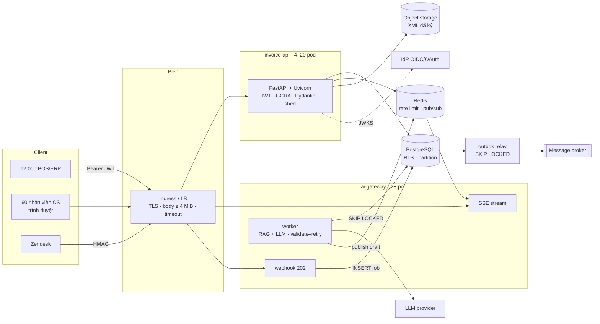

# Module 14 — Capstone: thiết kế hệ thống end-to-end

> Thời lượng: ~55 phút · Mức độ: Nâng cao · Tiên quyết: Module 00–13

Module này ghép mọi thứ lại thành một bản thiết kế hoàn chỉnh cho hai dịch vụ của Mekong Cloud, theo đúng format của một buổi phỏng vấn **system design**:

- yêu cầu → ước lượng → hợp đồng API → mô hình dữ liệu → kiến trúc;
- luồng xử lý chi tiết → các vấn đề xuyên suốt (idempotency, multi-tenant, bảo mật, quan sát) → kế hoạch test → rollout → rủi ro.

Khác với một bài phỏng vấn, ở đây ta **kiểm chứng ước lượng bằng số đo**. `scripts/bench/capstone_app.py` là một `invoice-api` thu gọn nhưng đầy đủ đường nóng: JWT EdDSA, GCRA trên Redis, Pydantic, Postgres với RLS, idempotency, cấp số, outbox, load shedding. `bench_capstone.py` đo ngân sách latency và năng lực thật của một pod. Kết quả có một điều bất ngờ: nút thắt **không phải** chỗ mà phần lớn người làm sẽ đoán.

## Mục tiêu học tập

Sau module này, bạn có thể:

1. Trình bày một bản thiết kế API theo đúng trình tự system design, mỗi quyết định có một con số đi kèm.
2. Làm **ước lượng nhanh** (back-of-envelope) cho tải, lưu trữ, số kết nối, số lời gọi LLM đồng thời; rồi **kiểm chứng** bằng đo đạc.
3. Viết luồng xử lý chi tiết của `POST /v1/invoices` và của chuỗi webhook → LLM → SSE, chỉ ra vị trí của từng cơ chế trong các module trước.
4. Đọc kết quả load test để chọn số pod, kích thước pool, ngưỡng load shedding; tìm nút thắt bằng phân rã CPU.
5. Lập kế hoạch rollout an toàn và bảng rủi ro.
6. Trả lời 14 câu hỏi phỏng vấn system design xoay quanh hai dịch vụ.

---

## 1. Đề bài và yêu cầu

### 1.1. Yêu cầu chức năng

**`invoice-api`** (12.000 máy POS/ERP của 3.000 doanh nghiệp):

- Tạo hóa đơn (`POST /v1/invoices`, một hoặc batch tối đa 500), có `Idempotency-Key`.
- Tra cứu (`GET /v1/invoices/{id}`, danh sách theo cursor), tải PDF/XML đã ký.
- Điều chỉnh / thay thế hóa đơn đã ký. Không sửa trực tiếp.
- Phát sự kiện `invoice.created` cho kế toán, email, đồng bộ cơ quan thuế.

**`ai-gateway`** (hệ thống AI tư vấn khách hàng qua Zendesk):

- Nhận webhook ticket mới từ Zendesk, chạy pipeline RAG + LLM, tạo **draft** trả lời có cấu trúc (Pydantic).
- Đẩy draft tới ~60 nhân viên CS qua **SSE**, ngay khi từng phần được sinh ra.
- Cung cấp tool cho agent qua MCP (tra hóa đơn, tra đơn hàng).

### 1.2. Yêu cầu phi chức năng

| | `invoice-api` | `ai-gateway` |
|---|---|---|
| Tải | 1,8 triệu req/ngày; đỉnh 420 req/s; **thiết kế 500 req/s** | 3.000 lượt/ngày; đỉnh 0,4 lượt/s; 60 kết nối SSE |
| Latency | p99 `POST` ≤ **300 ms** | webhook trả lời < 10 s; draft sẵn sàng < 60 s (p99) |
| Sẵn sàng | 99,9% / 30 ngày | 99% / 30 ngày |
| Đúng đắn | không trùng, không nhảy số hóa đơn; không lộ chéo tenant; không tạo trùng khi POS gửi lại | không xử lý trùng một ticket; không tin output LLM |
| Bảo mật | OWASP API Top 10; MST, doanh thu là dữ liệu nhạy cảm | PII trong email; prompt injection |

---

## 2. Ước lượng nhanh

### 2.1. Tải

Theo case thống nhất của khóa: 1,8 triệu request/ngày, 85% rơi vào 12 giờ bán hàng.

$$
\lambda_{\text{giờ bán}} = \frac{0{,}85 \times 1{,}8 \times 10^6}{12 \times 3600} \approx 35 \text{ req/s}
\quad \to \quad
\lambda_{\text{đỉnh}} \approx 35 \times 4 = 140
\quad \to \quad
\lambda_{\text{cuối tháng}} \approx 140 \times 3 = 420 \text{ req/s}
$$

Thiết kế cho **500 req/s**, chừa ~20% dự phòng trên đỉnh cuối tháng.

<!-- placeholder-load -->

<!-- fig:load -->
<figure markdown="span">
  { loading=lazy }
  { loading=lazy }
  <figcaption>Hình 14.1 — Ước lượng tải theo giờ của invoice-api từ giả định của case; đường đứt là mức thiết kế 500 req/s.</figcaption>
</figure>
<!-- /fig -->

### 2.2. Lưu trữ

60% request là `POST`, tức ~1,08 triệu hóa đơn/ngày.

| Dữ liệu | Mỗi hóa đơn | Mỗi ngày | Mỗi năm | Ở đâu |
|---|---|---|---|---|
| Hàng hóa đơn + 12 dòng + index (≈ 1,6× dữ liệu) | ~3,6 KB | ~3,9 GB | **~1,4 TB** | PostgreSQL, partition theo tháng |
| XML đã ký số | ~12 KB | ~13 GB | ~4,7 TB | object storage (S3-compatible), DB chỉ giữ khóa |
| Idempotency key (giữ 48 h) | ~150 B | ~160 MB | không tăng | PostgreSQL, partition theo ngày, `DROP` partition cũ |
| Outbox (giữ 7 ngày sau khi phát) | ~300 B | ~320 MB | không tăng | PostgreSQL |

Hai hệ quả thiết kế:

- **Partition theo tháng** cho `invoices` và `invoice_lines`, để truy vấn theo kỳ chỉ quét partition liên quan và để lưu trữ lạnh dữ liệu cũ dễ dàng.
- XML đã ký **không** nằm trong Postgres. 4,7 TB/năm dữ liệu chỉ ghi một lần, hiếm khi đọc, là việc của object storage.

### 2.3. Kết nối DB, tiến trình, LLM

- **Kết nối DB** (Module 10): mỗi `POST` giữ kết nối ~6,6 ms. Ở 500 req/s thì $a = 3{,}3$ erlang, nên Erlang C cho 8–10 kết nối là đủ **tổng cộng**. Chia cho số pod: mỗi pod 5 kết nối.
- **Tiến trình**: chưa biết CPU mỗi request là bao nhiêu, nên **phải đo** (mục 6). Module 09 gợi ý ~0,5 ms CPU cho HTTP + FastAPI, nhưng đó chưa tính tầng DB.
- **LLM đồng thời** của `ai-gateway` (Little): đỉnh 0,4 lượt/s × 30 s/lượt = **12 lời gọi LLM đồng thời**. Đây là con số để đặt hạn mức với nhà cung cấp và kích thước pool HTTP client.

---

## 3. Hợp đồng API

```text
POST   /v1/invoices                    tạo 1 hóa đơn       Idempotency-Key bắt buộc   201 | 401 | 403 | 409 | 422 | 429 | 503
POST   /v1/invoices:batch              tạo ≤ 500 hóa đơn   Idempotency-Key bắt buộc   207 Multi-Status
GET    /v1/invoices/{id}               đọc 1 hóa đơn                                   200 | 404
GET    /v1/invoices?cursor=&limit=     danh sách (keyset, Module 02)                   200
GET    /v1/invoices/{id}/xml           302 → URL ký sẵn của object storage            302 | 404
POST   /v1/invoices/{id}/replacements  thay thế hóa đơn đã ký (scope invoice:adjust)  201
POST   /v1/webhooks/zendesk            (ai-gateway) nhận ticket                       202
GET    /v1/drafts/{ticket_id}/stream   (ai-gateway) SSE: partial draft → final        200 text/event-stream
```

Quy ước chung:

- Lỗi theo **RFC 9457 Problem Details** (Module 07).
- Mọi mã lỗi có thể xảy ra đều **khai báo trong OpenAPI**, vì Schemathesis ở Module 12 đã cho thấy cái giá của việc quên.
- OpenAPI nằm trong repo và được diff ở mỗi PR (Module 12).
- Model request dùng `extra="forbid"`, trường tiền dùng `strict` (Module 11, 12).
- Model response chỉ chứa trường công khai.

---

## 4. Mô hình dữ liệu

<!-- placeholder-datamodel -->

<!-- fig:datamodel -->
<figure markdown="span">
  { loading=lazy }
  { loading=lazy }
  <figcaption>Hình 14.2 — Mô hình dữ liệu của invoice-api; mọi bảng mang tenant_id và chịu RLS.</figcaption>
</figure>
<!-- /fig -->

Các quyết định chính, mỗi cái trỏ về module đã chứng minh nó:

| Quyết định | Lý do (module) |
|---|---|
| Mọi bảng có `tenant_id`, RLS `FORCE` + `WITH CHECK`, app dùng role `app` không sở hữu bảng | BOLA (M11); `SET LOCAL` chống rò qua pool (M10 `d4leak`) |
| `series(tenant_id, series, last_number)` + `UNIQUE (tenant_id, series, number)` | cấp số liên tục; `MAX()+1` trùng 371/400 (M10 `d2`) |
| `idempotency(tenant_id, key) PK`, lưu `request_hash`, `status_code`, `response_body` | `ON CONFLICT` trước: 1 hóa đơn/khóa (M10 `d3`) |
| `outbox` cùng transaction, relay `SKIP LOCKED` | không mất sự kiện; 37k sự kiện/s với 4 relay (M10 `d7`) |
| Tiền là `bigint` VND, số lượng `numeric(19,4)` | tiền nguyên, không float (M01, M04) |
| Index `(tenant_id, issued_at desc, id)` | danh sách theo cursor (M02) |
| Migration expand/contract, `lock_timeout` | không chặn truy vấn khi deploy (M10 `d6`) |

---

## 5. Kiến trúc



Hai dịch vụ dùng chung PostgreSQL (khác schema, khác role) và Redis. Đây là lựa chọn có chủ đích cho quy mô hiện tại: tải DB của cả hai cộng lại vẫn nhỏ (mục 2.3), và một hệ quản trị ít hơn là một nguồn sự cố ít hơn. Ranh giới tách được về sau đã sẵn: mỗi dịch vụ chỉ dùng schema và role của mình.

---

## 6. Luồng `POST /v1/invoices` và ngân sách latency

### 6.1. Các bước

```mermaid
sequenceDiagram
    autonumber
    participant P as POS
    participant L as Ingress
    participant A as invoice-api
    participant R as Redis
    participant D as PostgreSQL
    P->>L: POST /v1/invoices (Idempotency-Key, JWT, 5 KB)
    L->>A: body ≤ 4 MiB? (413 nếu không)
    A->>A: InFlightLimit (503 nếu > ngưỡng)
    A->>A: kiểm JWT EdDSA, Principal (401/403)
    A->>R: GCRA rl:{tenant} (429 nếu hết hạn mức)
    A->>A: model_validate_json(body thô) — MST, thuế, tổng (422)
    A->>D: BEGIN; SET LOCAL app.tenant_id
    A->>D: INSERT idempotency ON CONFLICT DO NOTHING
    alt khóa đã có
        D-->>A: response đã lưu → 201 Idempotent-Replayed / 422 nếu khác payload
    else giành được
        A->>D: INSERT invoice + 12 lines
        A->>D: UPDATE series … RETURNING (cấp số, cuối transaction)
        A->>D: INSERT outbox; UPDATE idempotency SET response
    end
    A->>D: COMMIT (trước khi trả 201)
    A-->>P: 201 InvoiceOut
```

### 6.2. Ngân sách latency đo được

Thí nghiệm `c1` đo từng thành phần, và toàn bộ request qua ASGI trong tiến trình, tuần tự từng request một, với Postgres và Redis thật:

| Thành phần | µs |
|---|---|
| kiểm JWT EdDSA + `Principal` | 148 |
| GCRA trên Redis (1 round trip) | 136 |
| `model_validate_json` hóa đơn 12 dòng (MST, thuế, tổng) | **58** |
| băm model cho idempotency | 16 |
| transaction Postgres (8 câu lệnh, RLS, commit) | **6.789** |
| **toàn bộ `POST`** (p50 / p99) | **8.419 / 14.829** |

<!-- placeholder-budget -->

<!-- fig:budget -->
<figure markdown="span">
  { loading=lazy }
  { loading=lazy }
  <figcaption>Hình 14.3 — Số đo thật: ngân sách latency của một POST /v1/invoices; transaction DB chiếm phần lớn, Pydantic chưa tới 1%.</figcaption>
</figure>
<!-- /fig -->

So với ngân sách p99 300 ms, một request đơn lẻ dùng chưa tới 5%. Phần lớn thời gian nằm ở **transaction DB**, và Pydantic chỉ chiếm **0,7%**. Nhưng latency khi **không tải** chưa nói gì về năng lực. Câu hỏi thật là: một pod chịu được bao nhiêu request/s trước khi p99 vượt 300 ms?

---

## 7. Kiểm chứng năng lực: load test và một phát hiện

### 7.1. Load test open-loop

Thí nghiệm `c2` dùng uvicorn thật (uvloop + httptools), pool 8, load shedding 64 in-flight. Tải là `POST` 12 dòng theo quá trình Poisson, mỗi request có `Idempotency-Key` riêng, token của 50 tenant xoay vòng, chạy 8 giây sau 1 giây làm nóng. Máy đo có 4 vCPU, dùng chung cho uvicorn, Postgres, Redis **và** bộ sinh tải.

| Lớp DB | Tiến trình | Tải gửi | 201/s | p50 | **p99** | CPU server / request |
|---|---|---|---|---|---|---|
| SQLAlchemy `text()` | 1 | 100 | 98 | 14 ms | 100 ms | 6,4 ms |
| SQLAlchemy `text()` | 1 | 200 | 195 | 55 ms | **686 ms** | 5,5 ms |
| SQLAlchemy `text()` | 1 | 300 | 207 (bão hòa) | 266 ms | 1.293 ms | — |
| SQLAlchemy `text()` | 2 | 300 | 299 | 24 ms | 107 ms | 5,7 ms |
| SQLAlchemy `text()` | 2 | 500 | 420 (bão hòa) | 208 ms | 1.013 ms | — |
| **asyncpg thuần** | 1 | 200 | 197 | 9 ms | **38 ms** | 3,1 ms |
| **asyncpg thuần** | 1 | 300 | 299 | 21 ms | 168 ms | 3,1 ms |
| **asyncpg thuần** | 2 | 400 | 396 | 9 ms | 32 ms | 3,2 ms |
| **asyncpg thuần** | 2 | 600 | 596 | 24 ms | **96 ms** | 2,8 ms |
| **asyncpg thuần** | 2 | 800 | 694 (bão hòa) | 134 ms | 429 ms | — |

<!-- placeholder-capacity -->

<!-- fig:capacity -->
<figure markdown="span">
  { loading=lazy }
  { loading=lazy }
  <figcaption>Hình 14.4 — Số đo thật: thông lượng và p99 theo tải của invoice-api đầy đủ, với hai tầng truy cập DB và 1–2 tiến trình.</figcaption>
</figure>
<!-- /fig -->

Ba điều đọc ra:

1. **CPU của tiến trình server, không phải DB, là nút thắt.** Mỗi `POST` tốn ~5,5 ms CPU trong tiến trình Python (đo từ `/proc`), nên một tiến trình bão hòa ở ~1 / 0,0055 ≈ 180–210 req/s. Con số này khớp với thông lượng bão hòa đo được.
2. **Định luật Little được kiểm chứng lại.** Khi bão hòa, shedding giữ tối đa 64 request in-flight. Với thông lượng ~210/s, latency trung vị phải là $64 / 210 \approx 0{,}30$ s, và đo được 266–281 ms. Muốn p99 khi quá tải thấp hơn, hạ ngưỡng xuống $210 \times 0{,}1 \approx 20$ (Module 13).
3. **Đổi tầng truy cập DB nhân đôi năng lực.** Cùng các câu SQL, cùng transaction, chỉ thay SQLAlchemy `text()` bằng asyncpg thuần: CPU mỗi request giảm từ ~5,5 xuống ~3,1 ms. Một tiến trình chịu 300 req/s với p99 168 ms; hai tiến trình chịu **600 req/s với p99 96 ms**, vượt tải thiết kế.

### 7.2. CPU đi đâu? Phân rã

Thí nghiệm `c3` chạy riêng transaction `POST` (8 câu lệnh, 12 dòng) và đo **CPU của tiến trình Python**:

| Trường hợp | CPU Python | Thời gian |
|---|---|---|
| SQLAlchemy `text()`: transaction `POST` đầy đủ | **3,40 ms** | 5,91 ms |
| asyncpg thuần: cùng transaction | **0,80 ms** | 2,19 ms |
| SQLAlchemy: chỉ `executemany` 12 dòng | 1,52 ms | 3,09 ms |
| SQLAlchemy: transaction rỗng (begin + `set_config` + commit) | 0,95 ms | 1,15 ms |
| SQLAlchemy: 8 × `select 1` | 2,14 ms | 2,67 ms |
| asyncpg thuần: 8 × `select 1` | 0,45 ms | 0,73 ms |

<!-- placeholder-db-layer -->

<!-- fig:db-layer -->
<figure markdown="span">
  { loading=lazy }
  { loading=lazy }
  <figcaption>Hình 14.5 — Số đo thật: CPU phía Python của cùng một transaction qua SQLAlchemy text() và asyncpg thuần.</figcaption>
</figure>
<!-- /fig -->

Mỗi câu lệnh qua SQLAlchemy async tốn khoảng **0,25 ms CPU** cho phần "khung": compile `text()`, xử lý tham số, chuyển qua lại giữa greenlet và coroutine, tạo `Result`. asyncpg thuần chỉ tốn ~0,06 ms. Với 8–9 câu lệnh mỗi request, phần khung đó là ~2,5 ms, **gấp 40 lần** chi phí validation Pydantic của cả hóa đơn.

Đây là bài học Amdahl của Module 06 ở quy mô hệ thống: tối ưu thứ chiếm 0,7% (Pydantic) không bao giờ đáng công bằng tối ưu thứ chiếm 50% (tầng DB). Và chỉ **đo** mới cho biết đâu là 50%.

Quyết định thiết kế:

- **Giữ SQLAlchemy** cho phần lớn codebase: model, migration (Alembic), truy vấn đọc phức tạp, công cụ quản trị. Năng suất và độ an toàn của nó đáng giá hơn 0,25 ms ở những chỗ không nóng.
- **Viết đường nóng `POST /v1/invoices` bằng asyncpg** qua một lớp repository nhỏ (giống `Tx` trong `capstone_app.py`). Giữ cùng câu SQL, cùng transaction và cùng test tích hợp của Module 12, để thay đổi được kiểm chứng.
- Hoặc giữ SQLAlchemy và **giảm số câu lệnh**: gộp `UPDATE series` + `UPDATE invoices` + `INSERT outbox` + `UPDATE idempotency` vào một CTE. Ít round trip hơn thì ít CPU hơn, bất kể tầng nào.

### 7.3. Số pod

Đo trên máy chia sẻ CPU, nên đây là **ước lượng thận trọng**. Production chạy uvicorn trên node riêng, không chung với DB và bộ sinh tải.

| | SQLAlchemy | asyncpg đường nóng |
|---|---|---|
| Năng lực 1 tiến trình (p99 ≤ 300 ms) | ~200 req/s | ~300 req/s |
| Pod cần cho 500 req/s ở ρ ≤ 0,6 | $500 / (200 \times 0{,}6) \approx 4{,}2$ → **5** | $500 / (300 \times 0{,}6) \approx 2{,}8$ → **3** |
| Thêm 1 pod dự phòng (N+1) | 6 | 4 |
| Kết nối DB (5/pod) | 30 | 20 |

Chọn **asyncpg cho đường nóng + 4 pod tối thiểu**, HPA tới 20 theo CPU 60%. Tổng kết nối DB ở tải thiết kế là 20, đúng mức tối ưu của một Postgres 8 vCPU (Module 10, `d5`). Khi autoscale vượt 6–8 pod, đặt PgBouncer.

---

## 8. Luồng `ai-gateway`: webhook → LLM → SSE

<!-- placeholder-aiflow -->

<!-- fig:aiflow -->
<figure markdown="span">
  { loading=lazy }
  { loading=lazy }
  <figcaption>Hình 14.6 — Luồng ai-gateway: webhook trả 202 ngay, worker gọi LLM, draft đẩy qua Redis tới SSE.</figcaption>
</figure>
<!-- /fig -->

1. **Webhook** `POST /v1/webhooks/zendesk`:
    - kiểm chữ ký HMAC của Zendesk, validate payload (Pydantic);
    - `INSERT job … ON CONFLICT (ticket_id, event_id) DO NOTHING` (idempotent theo sự kiện Zendesk);
    - trả **202** trong vài ms, **không** gọi LLM trong request webhook (yêu cầu < 10 s; LLM mất 5–30 s).
2. **Worker** lấy job bằng `SELECT … FOR UPDATE SKIP LOCKED` (Module 10, `d7`). Trong một vòng lặp:
    - truy hồi tài liệu (RAG);
    - gọi LLM với **structured output** theo schema Pydantic `Draft` (Module 15);
    - **validate**, nếu sai thì retry có giới hạn với backoff (Module 13). Retry budget theo tenant và circuit breaker theo provider.
3. Trong lúc LLM sinh, worker **parse JSON từng phần** (partial validation, Module 15) và `PUBLISH` từng phần draft vào Redis channel `draft:{ticket_id}`.
4. **SSE** `GET /v1/drafts/{ticket_id}/stream`:
    - FastAPI `EventSourceResponse` subscribe channel và đẩy từng sự kiện;
    - có `id:` để client kết nối lại bằng `Last-Event-ID`, cùng heartbeat 15 s;
    - session DB (nếu cần) dùng `Depends(scope="request")` vì nó phải sống qua cả stream (Module 08).
5. Draft cuối cùng được lưu, và nhân viên CS duyệt rồi gửi. **Output LLM không bao giờ tự động gửi cho khách.** Nó là dữ liệu chưa tin cậy (API10, Module 11).

Năng lực: 12 lời gọi LLM đồng thời ở đỉnh (mục 2.3). Mỗi lời gọi chỉ là một coroutine chờ I/O, nên một tiến trình `async def` giữ hàng trăm lời gọi như vậy dễ dàng (Module 09). Nút thắt là **hạn mức token của nhà cung cấp**, không phải CPU, nên ta giới hạn đồng thời bằng semaphore theo provider và theo tenant.

---

## 9. Các vấn đề xuyên suốt

| Vấn đề | `invoice-api` | `ai-gateway` | Module |
|---|---|---|---|
| Idempotency | `Idempotency-Key` + `ON CONFLICT` trước, lưu response | `event_id` của Zendesk; consumer outbox khử trùng | 10 |
| Multi-tenant | `tenant_id` từ JWT, RLS `FORCE`, `SET LOCAL`, 404 | tenant từ cấu hình Zendesk; hạn mức LLM theo tenant | 10, 11 |
| Xác thực | client credentials → JWT EdDSA 10 phút | HMAC webhook; OIDC + PKCE cho UI, cookie `HttpOnly` | 11 |
| Phân quyền | `Security(scopes)`; `extra="forbid"`; `InvoiceOut` | tool MCP chỉ đọc, giới hạn theo tenant | 11 |
| Tài nguyên | body ≤ 4 MiB, `max_length`, GCRA 200/s/tenant, in-flight ≤ 20 | giới hạn token/giờ/tenant, timeout LLM 45 s | 11, 13 |
| Quan sát | span server + metric; operation span tắt; log 1 dòng/request | operation span bật; span cho từng lời gọi LLM, kèm token | 13 |
| SLO | 99,9% POST không 5xx và < 300 ms | 99% draft < 60 s | 13 |

---

## 10. Kế hoạch test

| Tầng | Nội dung | Module |
|---|---|---|
| Unit + thuộc tính | MST (phát hiện lỗi 1 chữ số), thuế half-up (oracle `Fraction`), tổng = Σ dòng, round-trip mọi model | 12 |
| Tích hợp + DB | savepoint rollback; ma trận BOLA (tenant A ↔ B = 404); BFLA (vai trò × endpoint) | 11, 12 |
| Đồng thời | 50 request trùng khóa → 1 hóa đơn; 32 luồng cấp số → không trùng, không nhảy | 10 |
| Hợp đồng | diff OpenAPI chặn breaking; Schemathesis `--checks all` | 12 |
| Mutation | `domain/` trên diff mỗi PR | 12 |
| Tải | `bench_capstone.py`: p99 < 300 ms ở 500 req/s với số pod dự kiến; chạy trước mỗi release lớn | 14 |
| Hỗn loạn | Postgres chậm 10 s; Redis sập (fail open); LLM 503 hàng loạt (circuit breaker) | 13 |

---

## 11. Rollout

<!-- placeholder-rollout -->

<!-- fig:rollout -->
<figure markdown="span">
  { loading=lazy }
  { loading=lazy }
  <figcaption>Hình 14.7 — Rollout theo bậc canary có cổng SLO, migration expand trước và contract sau.</figcaption>
</figure>
<!-- /fig -->

1. **Migration expand** chạy như một job riêng, có `lock_timeout`, trước khi deploy code (Module 10).
2. **Canary**: 1% traffic (theo tenant, chọn tenant nội bộ trước) trong 30 phút, rồi 10% trong 1 giờ, 50%, 100%. Mỗi bậc được chặn bởi cổng SLO: burn rate canary < 2 và p99 canary ≤ p99 baseline × 1,2. Không đạt thì tự động rollback.
3. **Feature flag** cho hành vi mới, ví dụ đường nóng asyncpg, để bật/tắt theo tenant mà không cần deploy lại.
4. **Contract** (xóa cột cũ, gỡ endpoint deprecated) ở một lần deploy sau, khi metric cho thấy không còn ai dùng. Header `Deprecation`/`Sunset` đã gửi trước đó (Module 12).

---

## 12. Rủi ro

<!-- placeholder-risks -->

<!-- fig:risks -->
<figure markdown="span">
  { loading=lazy }
  { loading=lazy }
  <figcaption>Hình 14.8 — Ma trận rủi ro: khả năng xảy ra và tác động.</figcaption>
</figure>
<!-- /fig -->

| Rủi ro | Khả năng | Tác động | Giảm thiểu |
|---|---|---|---|
| Đỉnh cuối tháng vượt 500 req/s | trung bình | cao | HPA; load shedding 503 + `Retry-After`; POS retry có jitter + idempotency |
| Retry storm sau sự cố DB (metastable) | trung bình | rất cao | retry budget phía client SDK; shedding; circuit breaker (M13 `p3`) |
| Lộ dữ liệu chéo tenant | thấp | rất cao | RLS `FORCE` + `SET LOCAL` + test BOLA tự động + role riêng |
| Hóa đơn trùng / nhảy số | thấp | cao (pháp lý) | khóa hàng theo ký hiệu + `UNIQUE`; test đồng thời trong CI |
| Migration khóa bảng giờ cao điểm | trung bình | cao | `lock_timeout`, expand/contract, chạy ngoài giờ bán |
| Nhà cung cấp LLM sập/chậm | cao | trung bình | circuit breaker, provider dự phòng, draft là tùy chọn (CS vẫn trả lời tay được) |
| Prompt injection trong email | cao | trung bình | output qua Pydantic, tool MCP chỉ đọc, người duyệt trước khi gửi |
| Chi phí telemetry/LLM vượt dự toán | trung bình | trung bình | lấy mẫu trace; hạn mức token theo tenant; cảnh báo chi phí theo giờ |

---

## Lỗi thường gặp & cách xử lý

| Triệu chứng (trong buổi phỏng vấn hoặc thiết kế thật) | Nguyên nhân gốc | Cách xử lý |
|---|---|---|
| Thiết kế "đẹp" nhưng không có con số | bỏ qua bước ước lượng | λ, kích thước, Little, Erlang C trước khi vẽ kiến trúc |
| Chọn số pod theo cảm giác | không đo CPU/request | load test open-loop + đo CPU tiến trình |
| Tối ưu Pydantic/JSON trước | đoán nút thắt | phân rã CPU; Amdahl |
| Gọi LLM trong request webhook | không tách nhận việc và làm việc | 202 + hàng đợi (`SKIP LOCKED`) + worker |
| Một DB, một pool, không tính tổng kết nối | quên nhân số pod | tổng kết nối ≈ 2 × core DB; PgBouncer khi autoscale |
| Không nói tới hành vi khi quá tải | chỉ thiết kế cho trường hợp vui | load shedding, retry budget, metastable |
| Rollout "deploy rồi xem" | thiếu cổng SLO | canary theo tenant + burn rate + rollback tự động |

## Tóm tắt (cheat-sheet)

- **Trình tự**: yêu cầu → ước lượng → API → dữ liệu → kiến trúc → luồng chi tiết → vấn đề xuyên suốt → test → rollout → rủi ro.
- **Số của case**: 500 req/s thiết kế; p99 300 ms; 1,08 triệu hóa đơn/ngày (~1,4 TB/năm Postgres, ~4,7 TB/năm XML); 12 lời gọi LLM đồng thời.
- **Ngân sách đo được**: Pydantic 58 µs, JWT 148 µs, GCRA 136 µs, DB 6,8 ms; request đơn lẻ ~8 ms.
- **Năng lực đo được**: 1 tiến trình ~200 req/s (SQLAlchemy) / ~300 req/s (asyncpg đường nóng). Nút thắt là CPU của tầng truy cập DB (~0,25 ms/câu lệnh qua SQLAlchemy async).
- **Quyết định**: asyncpg cho đường nóng, 4–20 pod, 5 kết nối/pod, shedding ≈ năng lực × 0,1 s.
- **`ai-gateway`**: 202 + hàng đợi Postgres + worker + Redis pub/sub + SSE; output LLM qua Pydantic, người duyệt.

## Câu hỏi phỏng vấn system design

**1.** Ước lượng req/s đỉnh của `invoice-api` từ "1,8 triệu request/ngày". Vì sao không thiết kế cho trung bình 21 req/s?

<details markdown="1">
<summary>Đáp án</summary>

Trung bình cả ngày $1{,}8 \times 10^6 / 86.400 \approx 21$ req/s vô nghĩa vì tải không đều. 85% tải nằm trong 12 giờ bán hàng (~35 req/s), giờ cao điểm gấp 4 (~140), ngày cuối tháng gấp 3 nữa (~420). Hệ thống phải chịu được **đỉnh**, cộng dự phòng, nên thiết kế cho 500 req/s. Latency tăng phi tuyến khi utilization cao (Module 09), nên năng lực phải vượt đỉnh với ρ ≤ 0,6–0,7.

</details>

**2.** Bạn cần bao nhiêu kết nối Postgres cho 500 req/s? Trình bày cách tính.

<details markdown="1">
<summary>Đáp án</summary>

Đo thời gian giữ kết nối của một transaction POST: $S \approx 6{,}6$ ms. Theo Little: $a = \lambda S = 3{,}3$ kết nối bận trung bình. Erlang C cho xác suất chờ ~2% với 8 kết nối, ~0,2% với 10. Vậy tổng 8–10 kết nối là đủ, chia ra 5/pod cho 4 pod là 20, có dư. Đối chiếu phía DB: thông lượng tối ưu khi tổng kết nối đang chạy ≈ 2 × số core DB (Module 10, `d5`).

</details>

**3.** Load test cho thấy một pod bão hòa ở ~210 req/s dù DB còn rảnh. Bạn điều tra thế nào?

<details markdown="1">
<summary>Đáp án</summary>

(1) Đo CPU của tiến trình server mỗi request (`/proc/<pid>/stat` hoặc metric `process_cpu_seconds_total`): ~5,5 ms. Vậy 1 core / 5,5 ms ≈ 180–210 req/s, nên đây là bão hòa CPU của tiến trình. (2) Phân rã: đo riêng JWT, validation, Redis, transaction DB; rồi đo CPU (không phải wall time) của transaction qua SQLAlchemy và qua asyncpg thuần (`c3`): 3,4 ms so với 0,8 ms. (3) Kết luận: tầng truy cập DB chiếm phần lớn CPU. Sửa đường nóng, đo lại: năng lực tăng ~1,5×.

</details>

**4.** Vì sao không gọi LLM ngay trong request webhook của Zendesk?

<details markdown="1">
<summary>Đáp án</summary>

Zendesk chờ phản hồi trong giới hạn ngắn (< 10 s), còn LLM mất 5–30 s. Gọi trực tiếp sẽ timeout, và Zendesk retry, tạo việc trùng. Ngoài ra request webhook giữ tài nguyên suốt thời gian chờ LLM, và lỗi LLM thành lỗi webhook. Tách ra: webhook ghi job (idempotent theo `event_id`) và trả 202 trong vài ms; worker xử lý bất đồng bộ, có retry, circuit breaker và hạn mức.

</details>

**5.** Làm sao để 12.000 máy POS gửi lại request khi mất mạng mà không tạo hóa đơn trùng?

<details markdown="1">
<summary>Đáp án</summary>

Client sinh `Idempotency-Key` (UUID) **một lần cho mỗi giao dịch bán**, gửi lại cùng khóa khi retry. Server, trong cùng transaction tạo hóa đơn, `INSERT … ON CONFLICT DO NOTHING` vào bảng idempotency **trước** khi làm việc. Bản trùng chờ bản gốc commit rồi phát lại response đã lưu. Cùng khóa nhưng khác payload (so hash của model đã validate) → 422. Khóa giữ 48 giờ. Thí nghiệm: 50 request trùng → đúng 1 hóa đơn.

</details>

**6.** Thiết kế cấp số hóa đơn liên tục cho 3.000 tenant. Trần thông lượng là gì?

<details markdown="1">
<summary>Đáp án</summary>

Bảng `series(tenant_id, series, last_number)`, mỗi lần cấp `UPDATE … SET last_number = last_number + 1 RETURNING` ở **cuối** transaction, cộng `UNIQUE (tenant_id, series, number)`. Rollback thì số cũng rollback, nên không nhảy số. Khóa hàng tuần tự hóa các giao dịch **cùng ký hiệu**: trần là $1 / t_{\text{giữ khóa}}$ (~438/s khi giữ ~2,3 ms). 3.000 tenant có ký hiệu riêng nên chạy song song. Tenant cực lớn dùng nhiều ký hiệu (theo cửa hàng).

</details>

**7.** Một đồng nghiệp đề xuất bỏ RLS vì "repository đã luôn lọc `tenant_id`". Bạn trả lời thế nào?

<details markdown="1">
<summary>Đáp án</summary>

Repository lọc đúng là lớp chính, nhưng chỉ cần **một** truy vấn viết tay quên điều kiện (báo cáo, script, endpoint mới) là lộ dữ liệu của 2.999 doanh nghiệp khác (BOLA, OWASP API1). RLS là lưới an toàn ở tầng DB, gần như không tốn chi phí khi có index theo `tenant_id`. Điều kiện để RLS hiệu quả: `FORCE ROW LEVEL SECURITY`, role ứng dụng không sở hữu bảng, `SET LOCAL` (không phải `SET`) để không rò qua pool.

</details>

**8.** Khi tải vượt năng lực, `invoice-api` nên hành xử thế nào? Đặt các ngưỡng cụ thể.

<details markdown="1">
<summary>Đáp án</summary>

Từ chối sớm thay vì để mọi request chậm. Middleware giới hạn request **in-flight** theo Little: năng lực/pod (~300/s) × latency mục tiêu (0,1 s) ≈ 20–30. Vượt ngưỡng thì 503 + `Retry-After: 1`. Không dùng `--limit-concurrency` của uvicorn (đếm cả kết nối rảnh, Module 13). POS SDK retry với decorrelated jitter + retry budget + cùng `Idempotency-Key`. HPA thêm pod theo CPU 60%.

</details>

**9.** Đường nóng dùng asyncpg thuần, phần còn lại dùng SQLAlchemy. Rủi ro là gì và kiểm soát ra sao?

<details markdown="1">
<summary>Đáp án</summary>

Rủi ro: hai cách truy cập DB, nên SQL viết tay có thể lệch với model ORM khi schema đổi, và code khó đọc hơn. Kiểm soát: (1) đường asyncpg nằm trong **một** repository nhỏ, dùng tên cột tường minh; (2) cùng bộ test tích hợp + test đồng thời + property-based (round-trip qua HTTP + DB) chạy cho cả hai; (3) migration expand/contract cập nhật cả hai trong cùng PR; (4) feature flag để tắt về SQLAlchemy nếu có lỗi. Chỉ làm vậy vì số đo cho thấy lợi ích ~1,5× năng lực trên đúng endpoint chiếm 60% traffic.

</details>

**10.** Thiết kế SSE cho draft của `ai-gateway` để chịu được rolling deploy.

<details markdown="1">
<summary>Đáp án</summary>

Mỗi sự kiện SSE có `id:` tăng dần. Worker publish vào Redis, và lưu bản draft mới nhất (hoặc log sự kiện ngắn hạn). Khi pod SSE nhận SIGTERM (sau `preStop`), nó gửi `retry: 1000` rồi đóng stream. Trình duyệt tự kết nối lại tới pod khác với header `Last-Event-ID`, và server gửi lại các sự kiện từ sau id đó. Heartbeat (comment `:`) mỗi 15 s để proxy không cắt kết nối rảnh. `terminationGracePeriodSeconds` dài hơn (60 s).

</details>

**11.** Bạn sẽ quan sát gì để biết `invoice-api` sắp gặp sự cố **trước khi** người dùng thấy?

<details markdown="1">
<summary>Đáp án</summary>

Tín hiệu bão hòa (USE), vì chúng tăng trước latency:

- thời gian chờ pool DB, số kết nối đang mượn;
- độ trễ event loop;
- số request in-flight so với ngưỡng shedding, và tỉ lệ 503;
- CPU tiến trình so với ~5 ms × req/s;
- độ dài hàng đợi outbox chưa phát;
- `lock_wait` trong Postgres.

Kèm burn rate SLO cửa sổ ngắn. Và theo dõi **tải gửi tới** so với **goodput**: chênh lệch tăng là dấu hiệu retry khuếch đại (metastable).

</details>

**12.** Chi phí của OpenTelemetry trên đường nóng là bao nhiêu và bạn cấu hình thế nào?

<details markdown="1">
<summary>Đáp án</summary>

Số đo Module 13: span server +27 µs, operation span (4 span/request) +165 µs. Với ngân sách CPU ~3 ms/request sau tối ưu, operation span là +5%. Cấu hình cho `invoice-api`: chỉ span server, `exclude` probe, lấy mẫu đầu 5% bằng `ParentBased`, tail sampling ở collector để giữ 100% trace lỗi/chậm. Metric (rẻ, ~5 µs) đo mọi thứ. Log một dòng/request.

</details>

**13.** Dữ liệu tăng ~1,4 TB/năm trong Postgres. Kế hoạch 3 năm?

<details markdown="1">
<summary>Đáp án</summary>

Partition `invoices`/`invoice_lines` theo tháng (khai báo, Postgres native). Truy vấn luôn có khoảng thời gian, nên partition pruning chỉ quét tháng liên quan. Index nhỏ theo partition. Sau 12–24 tháng, chuyển partition cũ sang tablespace rẻ, hoặc tách ra cụm lưu trữ chỉ đọc. Hóa đơn phải lưu theo thời hạn pháp luật nên không xóa. XML đã ký ở object storage với lifecycle (chuyển lớp lưu trữ lạnh). Read replica cho báo cáo, để không tranh khóa với đường ghi (Module 10, `d6`).

</details>

**14.** Một đối tác lớn muốn gửi batch 500 hóa đơn trong một request. Thiết kế endpoint batch.

<details markdown="1">
<summary>Đáp án</summary>

`POST /v1/invoices:batch`, body ≤ 4 MiB (~2,5 MB cho 500 hóa đơn), `max_length=500`. Validate toàn bộ bằng `model_validate_json` một lần (~2,5 ms). Mỗi hóa đơn có **khóa idempotency riêng** (hoặc khóa batch + chỉ số) để retry từng phần được. Xử lý mỗi hóa đơn trong một savepoint, hoặc chia lô 50 hóa đơn/transaction, để một hóa đơn lỗi không hủy cả batch và transaction không giữ khóa quá lâu. Trả **207 Multi-Status** với kết quả từng phần tử. Rate limit tính theo **chi phí**: 500 đơn vị, không phải 1 (Module 11). Batch lớn chạy trên pool/worker riêng để không làm đói `POST` đơn lẻ.

</details>

## Bài tập thực hành

1. **Gộp câu lệnh bằng CTE.** Viết lại transaction `POST` trong `capstone_app.py` (bản SQLAlchemy) để `UPDATE series`, `UPDATE invoices`, `INSERT outbox`, `UPDATE idempotency` thành **một** câu lệnh CTE. Đo lại `c3` và `c2`: năng lực tăng bao nhiêu? So với asyncpg thuần thì sao?
2. **Ngưỡng shedding theo Little.** Chạy `c2` với `SHED=20` thay vì 64 ở tải 400/s. So sánh p99 và tỉ lệ 503.
3. **Batch.** Cài `POST /v1/invoices:batch` theo câu 14, kèm test đồng thời: hai batch trùng khóa idempotency gửi cùng lúc.
4. **Trình bày.** Trình bày bản thiết kế trong 20 phút theo đúng trình tự của module (yêu cầu → ước lượng → … → rủi ro), kể cả trả lời 3 câu hỏi ngẫu nhiên ở trên.

## Tài liệu tham khảo

Module này tổng hợp các nguồn của Module 00–13. Thêm:

- A. Xu. *System Design Interview — An Insider's Guide*, Vol. 1–2. ByteByteGo, 2020–2022 (format trình bày).
- M. Kleppmann. *Designing Data-Intensive Applications*. O'Reilly, 2017 (chương 5–9: replication, partitioning, transactions, consistency).
- J. Dean. *Designs, Lessons and Advice from Building Large Distributed Systems* (LADIS keynote, 2009); bảng "Numbers Everyone Should Know".
- PostgreSQL 16 Documentation: [Table Partitioning](https://www.postgresql.org/docs/16/ddl-partitioning.html).
- asyncpg Documentation: [Usage — Connection pools](https://magicstack.github.io/asyncpg/current/usage.html#connection-pools).
- SQLAlchemy 2.1 Documentation: [Asyncio — Using multiple asyncio event loops / performance considerations](https://docs.sqlalchemy.org/en/21/orm/extensions/asyncio.html).
- Zendesk Developer Docs: [Webhooks — Verifying webhook authenticity](https://developer.zendesk.com/documentation/webhooks/verifying/).
- WHATWG HTML Standard: [Server-sent events](https://html.spec.whatwg.org/multipage/server-sent-events.html) (`id`, `retry`, `Last-Event-ID`).
