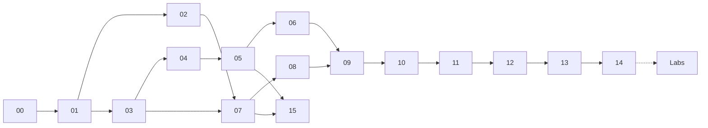

---
hide:
  - navigation
---

# Pydantic & FastAPI Masterclass

**Từ lý thuyết kiểu dữ liệu đến hệ thống API production — xoay quanh hai dịch vụ của một công ty SaaS: API hóa đơn điện tử và AI gateway.**

Giáo trình tiếng Việt khoảng **12 giờ học phần lõi** (Module 00–14, Lab 01–05) cộng **~1,5 giờ chuyên đề** (Module 15, Lab 06), kèm **bộ slide seminar**. Mọi khái niệm đi theo cùng một nhịp: *vấn đề → trực giác → lý thuyết (có ví dụ số) → code chạy được → cách vận hành bên trong → trade-off → case thực tế*. Khác với tài liệu hướng dẫn thông thường, mỗi module có **8–15 hình**: sơ đồ quy trình, sơ đồ cơ chế bên trong và **đồ thị số liệu đo thật** bằng script trong repo.

-   :material-chart-line:{ .lg .middle } **Số liệu đo thật, không phải khẩu hiệu**

    ---

    Pydantic v2 so với v1, msgspec, marshmallow, attrs+cattrs trên payload hóa đơn; `def` vs `async def` vs code chặn event loop; latency theo utilization so với lý thuyết hàng đợi; N+1; chi phí băm mật khẩu. Script nằm trong `scripts/bench/`, chạy lại được.

-   :material-sitemap-outline:{ .lg .middle } **Thấy được cơ chế bên trong**

    ---

    Từ chữ ký hàm Python đến core schema Rust; từ socket đến handler qua ASGI; đồ thị dependency được giải ra sao; event loop, threadpool 40 luồng, pool kết nối, vòng đời một hóa đơn.

-   :material-book-education-outline:{ .lg .middle } **Lý thuyết và nghiên cứu**

    ---

    Gradual typing, *parse, don't validate*, LangSec, REST (Fielding), định luật Little và M/M/c, *The Tail at Scale*, Dapper, metastable failures, property-based testing, fuzz theo OpenAPI, constrained decoding — kèm paper gốc.

-   :material-receipt-text-outline:{ .lg .middle } **Một case xuyên suốt**

    ---

    `invoice-api`: 3.000 doanh nghiệp, thiết kế cho 500 req/s, mã số thuế có chữ số kiểm tra, idempotency, multi-tenant. `ai-gateway`: webhook Zendesk, LLM 5–30 s, structured output, SSE.

## Bài toán

Mekong Cloud (công ty SaaS hư cấu, cũng là công ty trong [RAG Masterclass](https://hienguyen08.github.io/rag-masterclass/)) cần hai dịch vụ mới:

1. **`invoice-api`** — API công khai để máy POS/ERP của khách hàng tạo và tra cứu **hóa đơn điện tử**. Nhiều request ngắn, payload lồng nhau, quy tắc nghiệp vụ chặt (mã số thuế, thuế suất, tổng tiền), không được phép sai hay lộ dữ liệu giữa các doanh nghiệp.
2. **`ai-gateway`** — backend của hệ thống AI tư vấn khách hàng qua Zendesk: nhận webhook, gọi LLM mất 5–30 giây, ép output theo schema, stream bản nháp tới giao diện của agent CS.

Hai dịch vụ cố ý trái ngược nhau — **CPU-bound, nhiều request ngắn** và **I/O-bound, ít request dài** — để mọi quyết định (async hay sync, bao nhiêu worker, pool bao nhiêu kết nối, timeout bao lâu) đều phải lập luận bằng số. Xem chi tiết ở [Module 00](00-tong-quan-va-bai-toan.md).

## Mục lục

| Phần | Module | Nội dung chính | Thời lượng |
|---|---|---|---|
| **I · Nền tảng** | [00 · Tổng quan & bài toán](00-tong-quan-va-bai-toan.md) | Case Mekong Cloud, hệ sinh thái, bản đồ kiến thức | 20' |
| | [01 · Kiểu dữ liệu & validation](01-kieu-du-lieu-va-validation.md) | Gradual typing, *parse, don't validate*, LangSec, bằng chứng thực nghiệm | 45' |
| | [02 · HTTP, REST & ASGI](02-http-rest-asgi.md) | Ngữ nghĩa HTTP, REST, WSGI/ASGI, event loop, GIL & free-threading | 50' |
| **II · Pydantic** | [03 · Pydantic v2: kiến trúc](03-pydantic-v2-kien-truc.md) | Core schema, pydantic-core (Rust), lax/strict, cấu trúc lỗi, TypeAdapter | 50' |
| | [04 · Validator, kiểu tùy biến & union](04-validators-kieu-tuy-bien-union.md) | before/after/wrap/plain, Annotated pipeline, discriminated union, generic | 50' |
| | [05 · Serialization, JSON Schema & settings](05-serialization-json-schema-settings.md) | model_dump, alias, computed field, JSON Schema 2020-12, pydantic-settings | 45' |
| | 06 · Hiệu năng Pydantic | Benchmark thật 9 cách validate, mô hình chi phí, khi nào cần tối ưu | 45' |
| **III · FastAPI** | 07 · Vòng đời request | Từ chữ ký hàm đến response, response_model, middleware, OpenAPI, SSE | 50' |
| | 08 · Dependency injection | IoC, đồ thị dependency, yield, cache, override | 40' |
| | 09 · Async, đồng thời & hiệu năng | Event loop vs threadpool, Little, M/M/c, worker, tail latency | 55' |
| | 10 · Database & persistence | SQLAlchemy async, transaction, pool, N+1, migration, idempotency, RLS | 50' |
| | 11 · Bảo mật API | OAuth2/JWT, Argon2id, OWASP API Top 10, BOLA, rate limit, DoS | 50' |
| **IV · Vận hành** | 12 · Testing & chất lượng | Override, property-based, fuzz theo schema, breaking change | 45' |
| | 13 · Production & observability | Process model, probe, OTel, SLO, retry/jitter, metastable failure | 50' |
| | 14 · Capstone | Thiết kế end-to-end hai dịch vụ, câu hỏi system design | 55' |
| **V · Chuyên đề** | 15 · Pydantic cho LLM | Structured output, constrained decoding, tool calling, validate–retry | 50' |
| **Thực hành** | Labs 01–06 | Code chạy trên CPU, tái tạo mọi số liệu trong bài | ~2 giờ |
| **Seminar** | Slide thuyết trình | Bộ slide 60–90 phút, bản web và PDF | — |

## Cách học

- **Tuần tự** nếu mới với FastAPI: 00 → 14, mỗi buổi 1–2 module; làm Lab 01–02 sau Module 06, Lab 03–04 sau Module 10, Lab 05 sau Module 12.
- **Theo mục tiêu**:
    - Cần dựng API ngay → 03, 07, 08, 10, 11, Lab 03.
    - API chậm, cần tối ưu → 06, 09, 10, 13, Lab 02, Lab 04.
    - Làm backend cho LLM/agent → 05, 07 (SSE), 09, 15, Lab 06.
    - Chuẩn bị phỏng vấn backend → *Câu hỏi tự kiểm tra* cuối mỗi module và Module 14.
- **Giảng seminar** → slide đi theo mạch 00 → 01 → 03 → 06 → 07 → 09 → 14, mỗi slide ghi rõ module nguồn để người nghe đọc tiếp.

!!! tip "Đọc số liệu benchmark"
    Mọi con số đo trong khóa được chạy trên một container **4 vCPU, Python 3.13**. Chạy lại trên máy bạn sẽ ra số khác — hãy so **tỷ lệ** và **hình dạng đường cong**, đó mới là thứ mang theo được sang máy khác.

## Kiến thức tiên quyết

- Lập trình Python (hàm, class, decorator, context manager); biết đọc type hint cơ bản.
- Mạng máy tính mức đại học (TCP, HTTP); SQL cơ bản.
- Xác suất thống kê mức đại học (phân phối mũ, kỳ vọng) cho phần hàng đợi ở Module 09.

## Ghi chú về độ chính xác

- Số liệu quy mô của Mekong Cloud là **giả định để học**.
- Phiên bản thư viện, tính năng và văn bản pháp lý được cập nhật **tính đến 10/2026** (Pydantic 2.14, FastAPI 0.143, Starlette 1.8); hãy kiểm tra lại tài liệu chính thức khi dùng thật.
- Tài liệu tham khảo cuối mỗi module ưu tiên paper gốc và tài liệu chính thức. Thấy sai sót, hãy [mở issue](https://github.com/HieNguyen08/learn-pydantic-and-fastapi/issues).
